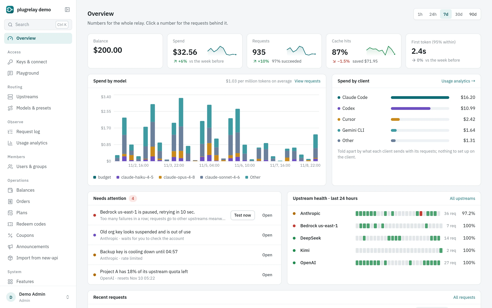
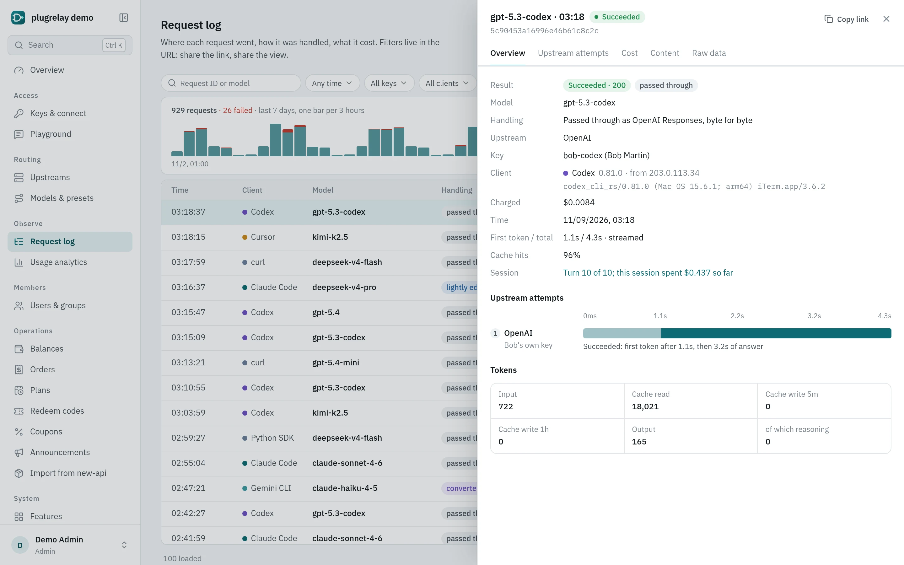
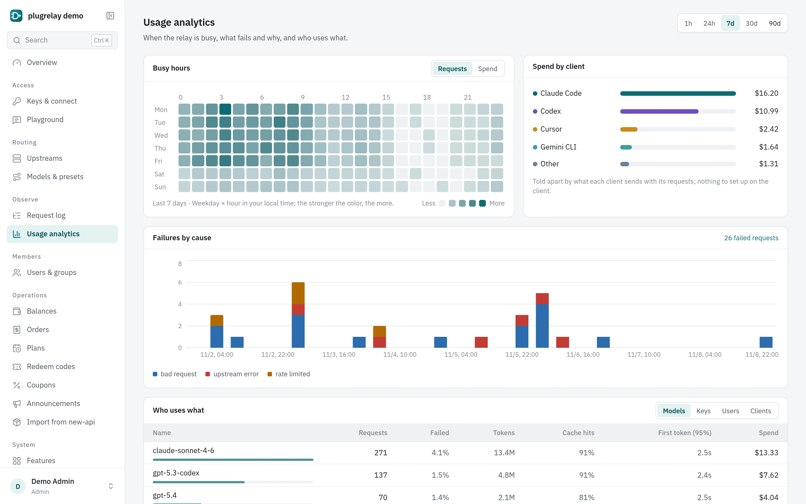
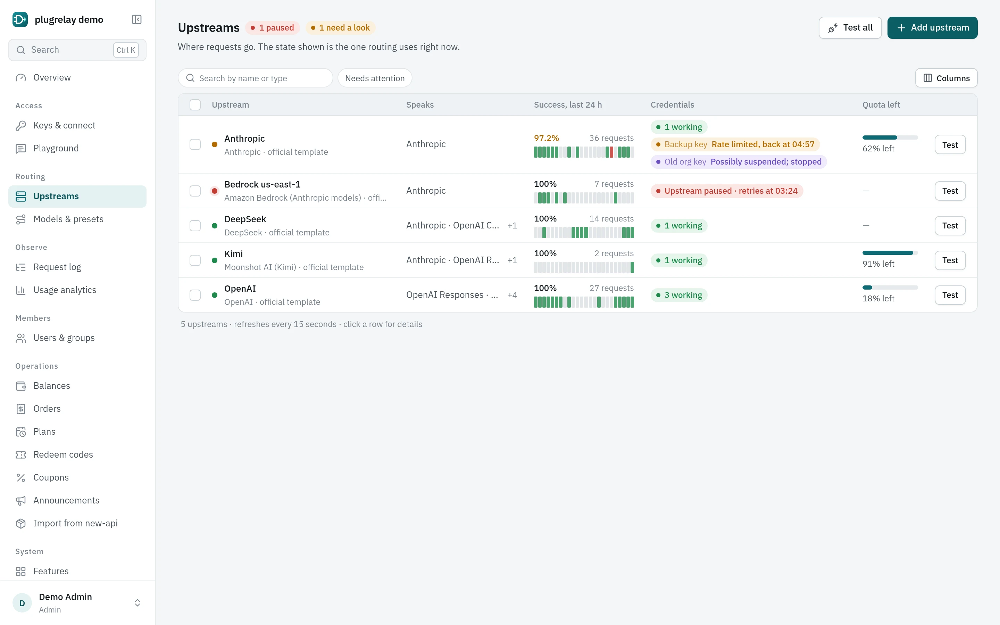
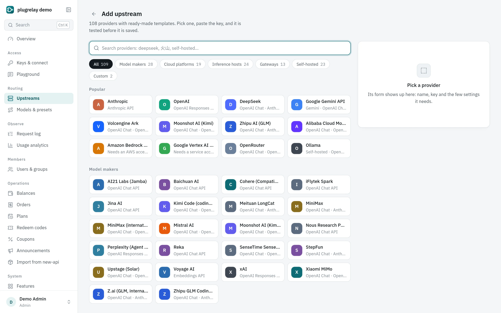
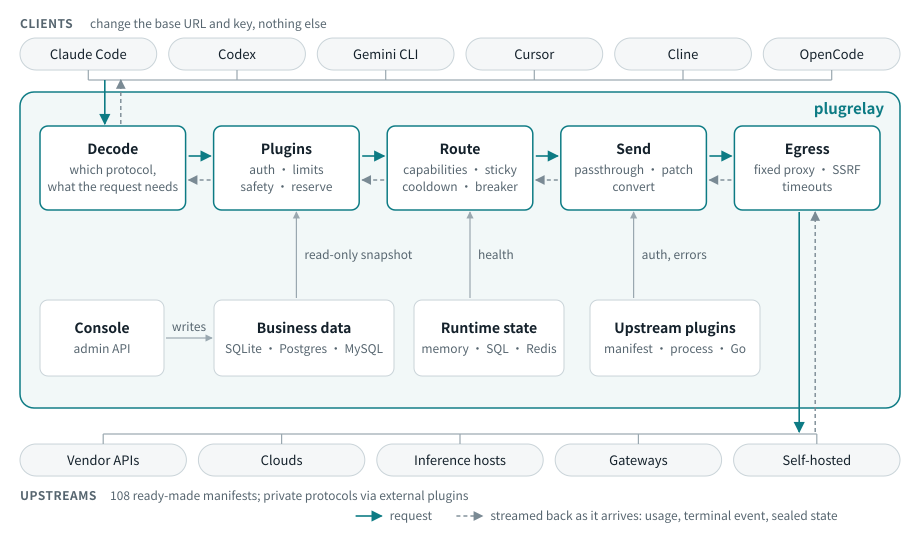

<p align="center">
  <picture>
    <source media="(prefers-color-scheme: dark)" srcset="docs/assets/logo-dark.svg">
    
  </picture>
</p>

<p align="center"><strong>An LLM relay for coding clients. Same protocol passes through untouched, different protocols convert by capability, and every request shows where it went and what it cost.</strong></p>

<p align="center">
  <a href="https://github.com/initxy/plugrelay/actions/workflows/ci.yml"></a>
  <a href="https://github.com/initxy/plugrelay/releases"></a>
  <a href="https://pkg.go.dev/github.com/initxy/plugrelay"></a>
  <a href="https://goreportcard.com/report/github.com/initxy/plugrelay"></a>
  <a href="LICENSE"></a>
</p>

<p align="center">English | <a href="README.zh-CN.md">简体中文</a></p>

<p align="center"><a href="#quickstart">Quickstart</a> · <a href="#screenshots">Screenshots</a> · <a href="#documentation">Docs</a> · <a href="docs/architecture.md">Architecture</a> · <a href="docs/comparison.md">Comparison</a></p>

<p align="center">
  <picture>
    <source media="(prefers-color-scheme: dark)" srcset="docs/images/overview.en.dark.webp">
    
  </picture>
</p>

plugrelay is an open-source LLM relay. Point Claude Code, Codex, Gemini CLI, Cursor, Cline or OpenCode at it by changing the base URL, and they keep working as before:

- When client and upstream speak the same protocol, the body goes through as is (at most the model name changes), so prompt caching hits as it would direct.
- When they don't, plugrelay compares what the request needs with what the upstream supports, fills only the gaps, and logs anything lost.
- A new upstream is a YAML manifest. Private protocols get an external plugin in any language.

## Why it is different

| | typical relays | plugrelay |
|-|-|-|
| Protocol conversion | everything through one vendor's format, or one converter per protocol pair | a same-protocol upstream first, passed through untouched; otherwise fill only the missing capabilities |
| New upstreams | change core code, or only a base URL | YAML for compatible upstreams; an external plugin for private protocols |
| Errors | one generic format, `retry-after` lost | the client protocol's native format; upstream text, status and `retry-after` come back |
| Prompt cache | round-robin, hits by luck | stay on the same credential while the cache is warm; add cache breakpoints across protocols |
| Thinking signatures | "Invalid signature" after switching channel | encrypted and handed to the client, returned next turn only to the upstream that issued it |
| Credentials | rotation pools, client impersonation | fixed egress and a concurrency cap per credential; automatic cooldown and quarantine. No pools, no impersonation |
| Transparency | a balance | every request shows the actual upstream, how it was processed, cache reads/writes and raw upstream usage |
| Compatibility | wait for bug reports | tests built from requests captured from real Claude Code and Codex, plus end-to-end tests against real upstreams |

## Screenshots

<table>
  <tr>
    <td width="50%"><br><sub><b>Request log</b>: each upstream attempt, how it was processed, cache reads and writes, raw upstream usage.</sub></td>
    <td width="50%"><br><sub><b>Usage analytics</b>: busy hours, failures by cause, spend by client and model.</sub></td>
  </tr>
  <tr>
    <td width="50%"><br><sub><b>Upstreams</b>: live state of every credential: cooling down, quarantined, breaker open, quota left.</sub></td>
    <td width="50%"><br><sub><b>Provider gallery</b>: pick a vendor, paste a key, test it.</sub></td>
  </tr>
</table>

To click around first, `plugrelay demo` starts a local instance with sample data and a fake upstream. Sign in as `admin@demo.local` / `plugrelay-demo`.

## Features

**Clients**
- Client protocols: Anthropic messages, OpenAI responses / chat / completions, Gemini. Also embeddings, images, audio, rerank, batches and Realtime WebSocket, sharing keys, routing, logs and billing with chat ([all routes](docs/clients.md#what-the-relay-serves)).
- Forgiving URLs: with or without `/v1`, trailing slashes, Azure's `api-version`. Model lists come back in the format the client asks for.
- The relay's own errors use the client protocol's native format; streams always end with the protocol's terminal event; keepalives go out while the upstream is queuing.

**Conversion**
- Each attempt uses the lightest handling that works: pass through, patch a few fields, or convert.
- An upstream missing a capability the request needs is left out of routing; only when none is left does the client get a 400 naming what is missing.
- Upstream-private state such as thinking signatures and encrypted reasoning is encrypted and handed to the client across protocols, then returned only to the upstream that issued it.

**Routing and credentials**
- Priority and weight. A preset bundles several models under one name that shows up in the client's model list; the client chooses it.
- A session stays on its credential while the cache is warm; requests from the same Codex turn stay on one credential.
- The upstream plugin decides what a failure means: rate limits cool down until reset, suspected bans quarantine at once, content refusals are not retried, repeated failures open a breaker.
- Credentials are shared, personal (owner only) or service accounts. Each has one fixed proxy; if the proxy is down the attempt fails rather than going direct.

**Visibility**
- The request log lists every upstream attempt: upstream, handling, latency, cost, cache reads/writes, raw upstream usage. Bodies are not logged by default.
- Recognizes which client sent a request; spend by client, model and session; CSV export.

**Upstreams**
- 108 ready-made manifests in [`manifests/`](manifests): vendors such as OpenAI, Anthropic, Gemini, DeepSeek, Kimi, GLM and Qwen; clouds such as Azure, Bedrock and Vertex; inference hosts such as Groq and SiliconFlow; gateways such as OpenRouter; self-hosted engines such as vLLM and Ollama. Each names the vendor docs it was checked against.
- External plugins talk JSON-RPC over stdio, with a Go SDK ([plugins](docs/plugins.md)).

**Optional features**
- Rate limits and quotas, routing policy, request log, content safety, billing, self sign-up, single sign-on, [MCP gateway](docs/mcp.md), [notifications](docs/notifications.md), price sync, public pages, metrics export. One switch and one settings form each ([configuration](docs/configuration.md#features)).
- To sell access: prepaid balance, redeem codes, Stripe and EasyPay, subscription plans, referral rewards, and an importer for new-api / one-api data ([sell kit](docs/sell-kit.md)).

**Deployment**
- One binary with the console built in, in English and Chinese, light and dark.
- SQLite (default), PostgreSQL or MySQL for data; Redis for state shared across nodes.
- Sign-in with password, OIDC / GitHub / Lark SSO, TOTP and passkeys.

## Quickstart

Build from source with Go 1.26+ and Node 20.19+:

```bash
git clone https://github.com/initxy/plugrelay && cd plugrelay
make web build                 # bin/plugrelay, console included
sudo install bin/plugrelay /usr/local/bin/
```

From the first release on, [Releases](https://github.com/initxy/plugrelay/releases) has linux / darwin / windows binaries for amd64 and arm64, and the image is `ghcr.io/initxy/plugrelay`. `go install` works too, but without the console.

Start a relay with DeepSeek behind it:

```bash
plugrelay init                                    # relay.yaml, master key, SQLite database
export DEEPSEEK_API_KEY=sk-...
plugrelay upstream add --manifest deepseek --credential-env DEEPSEEK_API_KEY
plugrelay model add --name deepseek-chat --route deepseek:deepseek-chat
plugrelay key create --name me                    # prints pr_... once
plugrelay serve                                   # http://127.0.0.1:8787
```

Point a client at it:

```bash
plugrelay setup claude-code --key pr_... --model deepseek-chat
plugrelay setup codex --key pr_... --model deepseek-chat
eval "$(plugrelay setup gemini --key pr_... --print)"
```

Other clients: [clients](docs/clients.md). Teams and Docker: [deployment](docs/deployment.md).

## Architecture

<p align="center"></p>

Every request takes the same path. No client or vendor is named in the core: client differences live in the protocol codecs, upstream differences in manifests and upstream plugins. More in [architecture](docs/architecture.md).

## Documentation

- [Architecture](docs/architecture.md): how a request flows, conversion, routing, egress rules
- [Clients](docs/clients.md): how to connect each client and what it loses behind a relay
- [Compatibility runs](docs/compat/README.md): real Claude Code and Codex tasks run through the relay
- [Configuration](docs/configuration.md): relay.yaml, environment, layered settings, YAML import/export
- [Deployment](docs/deployment.md): local, team, Docker Compose, security checklist, backups
- [Plugins](docs/plugins.md): YAML manifests, external plugins, built-in plugins, conformance suite
- [MCP gateway](docs/mcp.md) · [Notifications](docs/notifications.md) · [Sell kit](docs/sell-kit.md) · [Admin API](docs/api.md)
- [Comparison](docs/comparison.md): against new-api, sub2api, CLIProxyAPI, OpenRouter, LiteLLM and others, including where we fall short
- [Glossary](CONTEXT.md) · [ADRs](docs/adr/) · [Contributing](CONTRIBUTING.md) · [Security](SECURITY.md)

## Non-goals

- **No subscription pools.** Sharing a personal subscription among many people breaks vendor terms; plugrelay has no feature or hook for it.
- **No impersonating official clients.** No forged TLS fingerprints, headers, `metadata.user_id` or system prompts. Personal credentials serve their owner only.

## License

[Apache-2.0](LICENSE)
