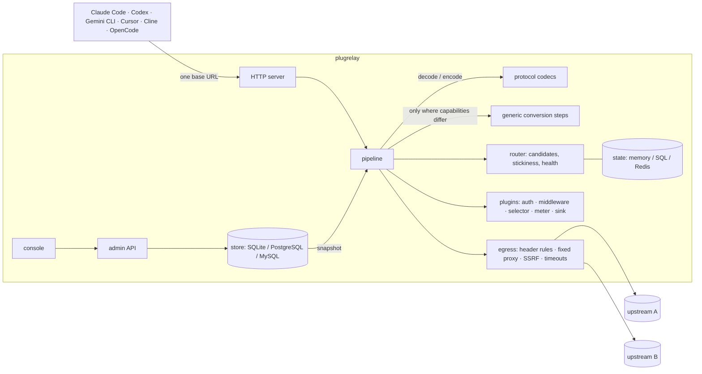

<p align="center">
  <picture>
    <source media="(prefers-color-scheme: dark)" srcset="docs/assets/logo-dark.svg">
    
  </picture>
</p>

<p align="center"><strong>One address for every coding client. Protocol-faithful, cache-friendly, and transparent about every request.</strong></p>

<p align="center">
  <a href="https://github.com/initxy/plugrelay/actions/workflows/ci.yml"></a>
  <a href="https://github.com/initxy/plugrelay/releases"></a>
  <a href="https://pkg.go.dev/github.com/initxy/plugrelay"></a>
  <a href="https://goreportcard.com/report/github.com/initxy/plugrelay"></a>
  <a href="LICENSE"></a>
</p>

<p align="center">English | [简体中文](README.zh-CN.md)</p>

<p align="center">[Quickstart](#quickstart) · [Screenshots](#screenshots) · [Docs](#documentation) · [Architecture](docs/architecture.md) · [Comparison](docs/comparison.md)</p>

<p align="center">
  <picture>
    <source media="(prefers-color-scheme: dark)" srcset="docs/images/overview.en.dark.webp">
    
  </picture>
</p>

plugrelay is an open-source LLM relay for coding clients. Point Claude Code,
Codex, Gemini CLI, Cursor, Cline, OpenCode and friends at one address and keep
their features: same-protocol traffic passes through untouched (at most the
model name or a usage flag is patched), so prompt caching works as well as a
direct connection; when a request must cross
protocols, plugrelay compares what the request needs with what the upstream
can do and runs a few generic conversion steps — no per-client or per-vendor
special cases. Upstreams, auth, billing and logging are plugins, written as a
YAML file, an external program in any language, or Go compiled in.

## Why it is different

| | typical relays | plugrelay |
|-|-|-|
| protocol conversion | convert everything through one vendor format, or a converter per protocol pair | same-protocol endpoint first, passed through untouched; otherwise a neutral format plus capability matching and fixed generic steps |
| adding an upstream | change core code, or only a base URL | a YAML manifest for compatible upstreams; an external plugin in any language for private protocols |
| errors | one generic format, `retry-after` lost | the client protocol's native error signals; upstream text, status and `retry-after` passed through |
| prompt cache | round-robin spreads sessions; cross-protocol rarely hits | stickiness decided by cache value; breakpoints or cache keys added across protocols |
| thinking signatures | "Invalid signature" after switching channel or protocol | all upstream-private state sealed and returned only to its issuer |
| credentials | rotation pools, client impersonation | fixed egress per credential, concurrency caps, quarantine, breakers; no pools, no impersonation |
| transparency | a balance and nothing else | every request shows the actual upstream, processing tier, cache reads/writes and raw upstream usage |
| compatibility | bug reports | request fixtures captured from real Claude Code and Codex, a live-upstream e2e suite and a provider conformance suite |

## Screenshots

<table>
  <tr>
    <td width="50%"><br><sub><b>Request log.</b> Every attempt, the upstream that served it, the processing tier, cache reads and writes, and the raw upstream usage.</sub></td>
    <td width="50%"><br><sub><b>Usage analytics.</b> Busy hours, failures by cause, spend by client and model.</sub></td>
  </tr>
  <tr>
    <td width="50%"><br><sub><b>Upstreams.</b> Live credential state: cooling down, quarantined, breaker open, quota left.</sub></td>
    <td width="50%"><br><sub><b>Provider gallery.</b> 108 ready-made manifests; pick one, paste a key, test it.</sub></td>
  </tr>
</table>

Try it locally with seeded data and a fake upstream: `plugrelay demo` (sign in as
`admin@demo.local` / `plugrelay-demo`).

## Features

**Client compatibility** ([routes](docs/clients.md#what-the-relay-serves))
- Anthropic messages, OpenAI responses, OpenAI chat, legacy `/v1/completions`
  (with fill-in-the-middle) and Gemini on the client side, with tolerant paths
  (`/v1` optional, trailing slashes, Azure `api-version`) and keys from
  `Authorization`, `x-api-key` or `x-goog-api-key`.
- Embeddings (OpenAI and Gemini), images, audio, rerank (Jina/Cohere v1 and
  Cohere v2 shapes) and OpenAI / Anthropic batches, through the same keys,
  routing, log and billing; an opt-in `/native/<upstream>/…` passthrough for
  vendor-only APIs.
- Model lists rendered per client (Codex catalog, Anthropic, Gemini, OpenAI).
- Native errors per client protocol; streams always end with the protocol's
  terminal event; keepalives while an upstream is busy.

**Protocol conversion with capability matching**
- Three tiers per attempt: passthrough (bytes untouched), patch (named fields
  edited in place), convert (neutral IR).
- Endpoints that cannot serve a request's needs are never routed; if none is
  left the client gets a 400 naming the missing capability.
- Every conversion graded lossless / lossy / discouraged with a diagnostic in
  the request log.

**Private-state sealing**
- Thinking signatures, encrypted reasoning and Gemini thought signatures
  survive protocol changes: sealed with AES-256-GCM under the master key and
  handed back only to the upstream that issued them.

**Routing and credentials**
- Priority and weight per route, group-restricted routes, one routing
  strategy (priority, cheapest, fastest, soonest quota reset), presets that
  clients see in their model list.
- Stickiness while the prompt cache is warm, a user kept on few credentials,
  same-turn pinning for Codex.
- Structured failure verdicts: cooldowns until the upstream's reset time,
  quarantine for suspected bans, no retries for content rejections, upstream
  breakers.
- Shared, personal (owner-only) and service credentials; fixed proxy per
  credential with no fallback to direct; SSRF guard on every upstream call.

**Transparency**
- A request log with every upstream attempt, its tier, latency, cost, cache
  reads/writes and raw upstream usage. Bodies are not stored unless enabled.
- The client program behind each request (Claude Code, Codex, …) detected
  from its headers; spend by client, requests grouped by session, CSV
  export, and usage analytics (busy hours by weekday, failures by cause).

**Plugins in three tiers**
- YAML manifests for upstreams — 108 official ones in [`manifests/`](manifests),
  each citing the vendor docs it was checked against:
  - model makers: OpenAI, Anthropic, Gemini, DeepSeek, Mistral, xAI, Cohere,
    AI21, Upstage, Reka, Perplexity, Kimi (China and international) and Kimi
    Code, GLM (China and Z.ai) and the GLM Coding Plan, MiniMax (China and
    international), Qwen (China and international), StepFun, Baichuan, iFlytek
    Spark, Xiaomi MiMo, SenseNova, Meituan LongCat, Jina AI, Voyage AI;
  - clouds: Azure OpenAI, Azure AI Foundry, Amazon Bedrock (native and
    OpenAI-compatible), Google Vertex AI (Claude and Gemini), Cloudflare
    Workers AI, Volcengine Ark and its Coding Plan, BytePlus ModelArk, Tencent
    TokenHub, Huawei Cloud MaaS, Oracle OCI Generative AI, Snowflake Cortex,
    Databricks, Scaleway, OVHcloud;
  - inference hosts: Groq, Together, Fireworks, Cerebras, SambaNova, NVIDIA
    NIM, DeepInfra, Hyperbolic, Novita, Nebius, Featherless, Friendli, Nscale,
    Chutes, Baseten, Parasail, Inference.net, Nous Portal, GMI Cloud,
    SiliconFlow, PPIO, Infini-AI, ModelScope, Gitee AI;
  - gateways: OpenRouter, Vercel AI Gateway, Hugging Face Inference
    Providers, Requesty, Poe, Martian, Helicone, Cloudflare AI Gateway,
    Portkey (hosted and self-hosted), LiteLLM proxy, Bifrost, New API, One API;
  - self-hosted: vLLM, SGLang, llama.cpp, Ollama, LM Studio, LocalAI, TGI,
    Xinference, LMDeploy, TensorRT-LLM, Triton, Ray Serve LLM, KServe, MindIE,
    OpenVINO Model Server, MLC LLM, Aphrodite, TabbyAPI, KoboldCpp, llamafile,
    Jan, the Infinity and TEI embedding servers, and a generic
    OpenAI-compatible one.
- External process plugins over JSON-RPC/stdio in any language, with a Go
  SDK.
- Built-in Go plugins: API-key auth, access rules, rate limits, parameter
  policy, redaction, guardrails (deny lists, PII and secret detection, size,
  model and tool limits, moderation; block, redact or flag, streams cut
  mid-way), routing strategies, quotas, request log, Prometheus metrics,
  model sync.
- Features instead of plugin switches: rate limits & quotas, routing,
  request log, content safety, billing, self sign-up, single sign-on, MCP
  gateway, notifications, price sync, public pages and metrics export, each
  one switch and one form with labels in English and Chinese
  ([configuration](docs/configuration.md#features)).
- MCP gateway: configured MCP servers behind the platform key at
  `/mcp/<server>`, or all of a key's tools at `/mcp`, with per-key grants,
  sealed server credentials and tool calls in the request log
  ([MCP](docs/mcp.md)).
- Notifications: a credential suspected banned or low on quota, an upstream
  paused, a budget nearly used up, by email, Feishu/Lark, DingTalk, WeCom or
  a signed webhook, which can also receive request records
  ([notifications](docs/notifications.md)).
- Price sync: suggested list prices from models.dev for the models you
  choose to follow; prices set by hand always win
  ([configuration](docs/configuration.md#price-sync)).
- Public pages: models with prices and per-model status, readable without
  signing in.
- Settings layered Global → Group → User → Key, each override, only-tighten
  or (deny lists) only-grow.
- Billing and self sign-up (built in, off by default): prepaid balance in
  real money with hold → charge → release, redeem codes, Stripe Checkout
  and epay (Alipay, WeChat Pay) top-ups with coupons, daily check-in and
  referral rewards, announcements, subscription plans with a period
  allowance, self-service sign-up and an importer for new-api / one-api
  sites ([sell kit](docs/sell-kit.md)).

**Storage**
- Business data in SQLite (default, pure Go), PostgreSQL or MySQL; shared runtime
  state in memory, SQL or Redis. `plugrelay export` / `apply` round-trip it as
  YAML.

**Console**
- Built in and served by the same binary: setup wizard (myself / team /
  sell), overview, keys with per-client connect snippets and a CC Switch
  import link, a playground, request log with attempt detail, analytics,
  upstreams with a searchable provider gallery and live credential state,
  models and presets, users and groups, features, notifications, settings,
  audit log, and the billing pages while billing is on; members get their
  own overview, keys, usage, models and prices, and status. Light and dark
  themes; English and Simplified Chinese, picked from the browser on first
  visit. It only uses public APIs: the [admin API](docs/api.md) and, on the
  billing pages, the sell kit's plugin routes.
- Sign-in by password, single sign-on (OIDC, GitHub, Feishu/Lark), TOTP
  two-step with recovery codes, passkeys, and an optional captcha after
  repeated failures
  ([deployment](docs/deployment.md#single-sign-on)).

## Quickstart

Build from source (Go 1.26+, Node 20.19+ for the console):

```bash
git clone https://github.com/initxy/plugrelay && cd plugrelay
make web build        # bin/plugrelay, console included
sudo install bin/plugrelay /usr/local/bin/
```

Release binaries and images appear with the first tagged release. Then
[GitHub Releases](https://github.com/initxy/plugrelay/releases) has
archives for linux, darwin and windows on amd64 and arm64:

```bash
tar xzf plugrelay_*_linux_amd64.tar.gz && sudo mv plugrelay /usr/local/bin/
```

and `ghcr.io/initxy/plugrelay` the image; run it as in
[docs/deployment.md](docs/deployment.md#single-container-with-sqlite).
`go install github.com/initxy/plugrelay/cmd/plugrelay@latest` builds too,
but with a placeholder console: git holds only a stub `web/dist/index.html`,
which `make web` replaces.

Set up a local relay with one upstream:

```bash
plugrelay init                                    # relay.yaml, master key, SQLite database
export DEEPSEEK_API_KEY=sk-...
plugrelay upstream add --manifest deepseek --credential-env DEEPSEEK_API_KEY
plugrelay model add --name deepseek-chat --route deepseek:deepseek-chat
plugrelay key create --name me                    # prints pr_... once
plugrelay serve                                   # http://127.0.0.1:8787
```

Connect a client:

```bash
plugrelay setup claude-code --key pr_... --model deepseek-chat
plugrelay setup codex --key pr_... --model deepseek-chat
eval "$(plugrelay setup gemini --key pr_... --print)"
```

Every other client: [docs/clients.md](docs/clients.md). Team and Docker
deployments: [docs/deployment.md](docs/deployment.md).

## Architecture



Details: [docs/architecture.md](docs/architecture.md).

## Documentation

- [Architecture](docs/architecture.md) — request lifecycle, tiers, conversion, sealing, routing, hard rules
- [Clients](docs/clients.md) — how to connect each client, and what it loses
- [Client compatibility record](docs/compat/README.md) — dated runs of real Claude Code and Codex through a relay, and the other live checks
- [Configuration](docs/configuration.md) — relay.yaml, environment, layered settings, YAML import/export
- [Deployment](docs/deployment.md) — local, team behind TLS, Docker Compose, security checklist, backups
- [Plugins](docs/plugins.md) — manifests, external plugins, built-in Go plugins, conformance suite
- [MCP gateway](docs/mcp.md) — MCP servers behind the platform key, grants, aggregation, client config
- [Notifications](docs/notifications.md) — alerts by email, Feishu, DingTalk, WeCom or webhook; request records to a webhook
- [Sell kit](docs/sell-kit.md) — balance, redeem codes, payments and coupons, subscription plans, check-in, referrals, announcements, sign-up, new-api import
- [Admin API](docs/api.md) — [`api/openapi.yaml`](api/openapi.yaml) and its auth model
- [Comparison](docs/comparison.md) — plugrelay vs new-api, sub2api, CLIProxyAPI, OpenRouter, LiteLLM, Portkey and others, with sources and known gaps
- [Glossary](CONTEXT.md) · [Decision records](docs/adr/) · [Contributing](CONTRIBUTING.md) · [Security](SECURITY.md)

## Non-goals

- **No subscription account pools.** Sharing consumer subscriptions across
  users breaks vendors' terms; plugrelay offers no feature or hook for it.
- **No client impersonation.** No forged TLS fingerprints, client headers,
  `metadata.user_id` or system prompts. Personal credentials serve only their
  owner.
- No client- or vendor-specific branches in the core: client quirks live in
  protocol codecs, upstream quirks in manifests and provider plugins.

## License

[Apache-2.0](LICENSE).
