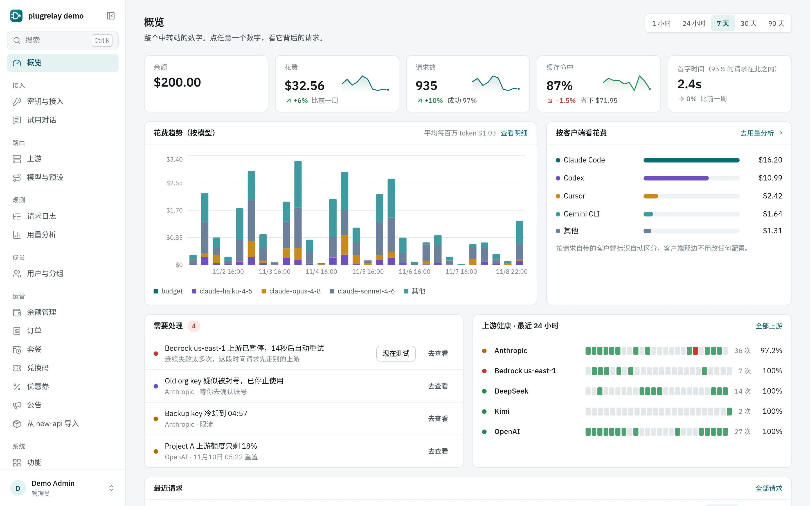
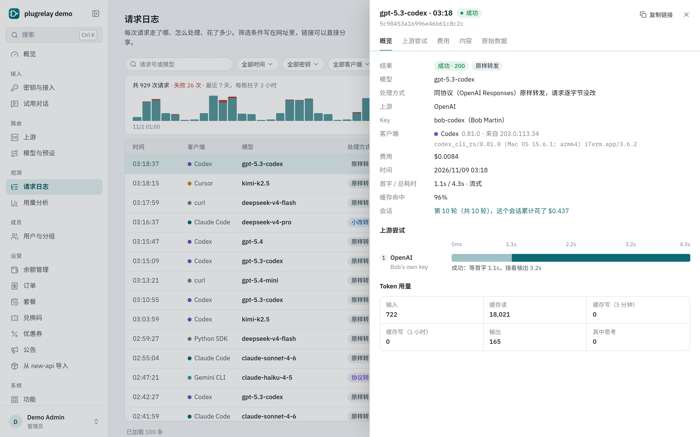
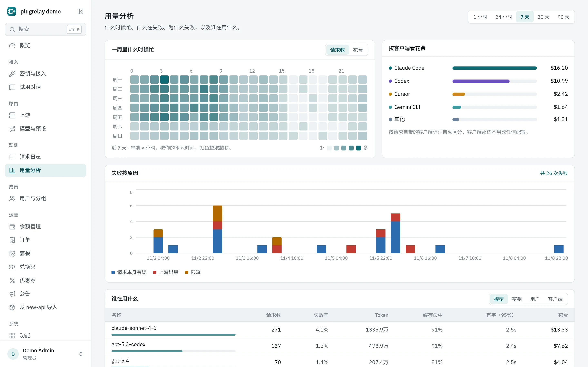
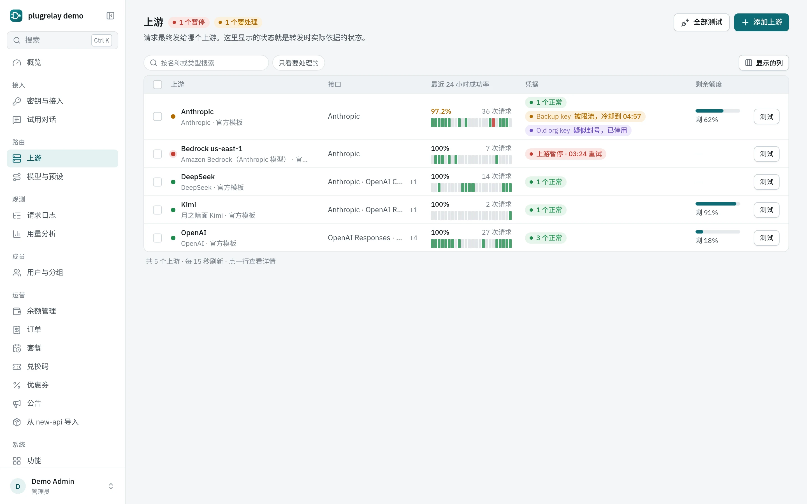
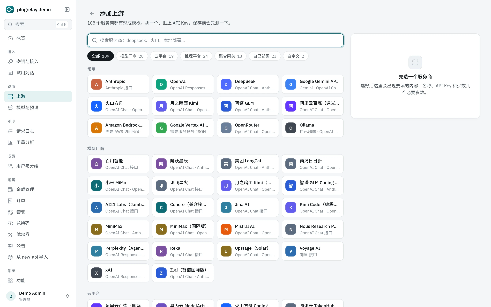
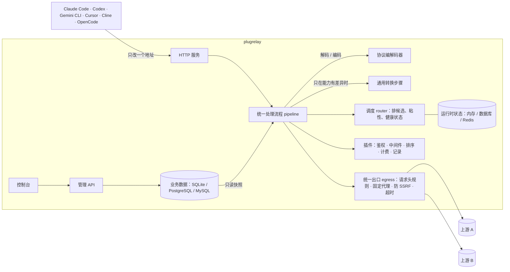

<p align="center">
  <picture>
    <source media="(prefers-color-scheme: dark)" srcset="docs/assets/logo-dark.svg">
    
  </picture>
</p>

<p align="center"><strong>一个地址接入所有编程客户端：协议原汁原味，缓存命中不打折，每次请求走了哪、花了多少都看得见。</strong></p>

<p align="center">
  <a href="https://github.com/initxy/plugrelay/actions/workflows/ci.yml"></a>
  <a href="https://github.com/initxy/plugrelay/releases"></a>
  <a href="https://pkg.go.dev/github.com/initxy/plugrelay"></a>
  <a href="https://goreportcard.com/report/github.com/initxy/plugrelay"></a>
  <a href="LICENSE"></a>
</p>

<p align="center">[English](README.md) | 简体中文</p>

<p align="center">[快速开始](#quickstart) · [截图](#screenshots) · [文档](#documentation) · [架构](docs/architecture.zh-CN.md) · [横向对比](docs/comparison.zh-CN.md)</p>

<p align="center">
  <picture>
    <source media="(prefers-color-scheme: dark)" srcset="docs/images/overview.zh-CN.dark.webp">
    
  </picture>
</p>

plugrelay 是一个开源的大模型中转站，给编程客户端用。Claude Code、Codex、Gemini CLI、Cursor、Cline、OpenCode 这些客户端改个地址就能接进来，功能不打折：客户端和上游说同一种协议时，请求原样透传（最多改一下模型名或补一个用量开关），缓存命中率和直连一样；必须换协议时，plugrelay 先比一比"这个请求要什么"和"这个上游能做什么"，只对差的部分跑几个固定的通用步骤，不为某个客户端或某家厂商写特例。上游、鉴权、计费、日志都是插件，可以写一份 YAML，也可以用任何语言写个外部程序，或者用 Go 编进去。

<a id="why-it-is-different"></a>
## 和常见中转站的区别

| | 常见做法 | plugrelay |
|-|-|-|
| 协议转换 | 统一转成某一家的格式，或者每两种协议之间单写一个转换器 | 优先选和客户端同协议的入口，原样透传；必须转换时走中立格式，按能力比对，只跑几个通用步骤 |
| 接新上游 | 改核心代码，或者只能填个地址 | 兼容的上游写一份 YAML 清单；私有协议用任何语言写外部插件 |
| 错误 | 统一成一种格式，`retry-after` 丢了 | 按客户端协议的原生格式和信号返回；上游原文、状态码、`retry-after` 都透传 |
| 缓存 | 轮询分摊，命中靠运气；跨协议基本不命中 | 是否粘在原凭据上看缓存还热不热；跨协议自动补缓存断点或缓存 key |
| 思考签名 | 换渠道、换协议就报 Invalid signature | 上游私有的状态统一加密带回，只还给签发它的上游 |
| 凭据 | 号池轮换、伪装官方客户端 | 每把凭据固定出口、限并发、可隔离、上游熔断；不做号池，不做伪装 |
| 透明度 | 只能看余额 | 每次请求都能查实际上游、处理方式、缓存读写和上游原始用量 |
| 兼容性 | 靠用户报 bug | 用真实 Claude Code、Codex 录下的请求做测试样本，有对真实上游跑的端到端测试，另有上游插件的一致性测试套件 |

<a id="screenshots"></a>
## 截图

<table>
  <tr>
    <td width="50%"><br><sub><b>请求日志。</b>每次尝试走了哪个上游、怎么处理的、缓存读写多少、上游原始用量是多少，全都列出来。</sub></td>
    <td width="50%"><br><sub><b>用量分析。</b>忙闲时段、失败原因，按客户端和模型看花费。</sub></td>
  </tr>
  <tr>
    <td width="50%"><br><sub><b>上游。</b>凭据的实时状态：冷却中、隔离、熔断、剩余额度。</sub></td>
    <td width="50%"><br><sub><b>厂商库。</b>108 份现成清单，选一个、填上 key、点测试就能用。</sub></td>
  </tr>
</table>

想自己点一点：`plugrelay demo` 会起一个带演示数据和假上游的本地中转站（登录 `admin@demo.local` / `plugrelay-demo`）。

<a id="features"></a>
## 功能

**客户端兼容**（[完整路由表](docs/clients.zh-CN.md#what-the-relay-serves)）
- 客户端一侧支持 Anthropic messages、OpenAI responses、OpenAI chat、Gemini，以及老式的 `/v1/completions`（含代码补全用的中间填空 fill-in-the-middle）。地址写法很宽容：带不带 `/v1`、末尾多个斜杠、Azure 风格的 `api-version` 都认；key 从 `Authorization`、`x-api-key`、`x-goog-api-key` 里都能取。
- 除了对话，还支持文本向量化 embeddings（OpenAI 和 Gemini 两种格式）、生图、语音、重排序 rerank（Jina/Cohere v1 和 Cohere v2 两种格式）、OpenAI 和 Anthropic 的批量任务 batches，和对话共用 key、选路、日志和计费；另有一个默认关闭的 `/native/<上游>/…`，把厂商独有的接口原样转发过去。
- 模型列表按客户端要的格式返回（Codex 的模型目录、Anthropic、Gemini、OpenAI）。
- relay 自己产生的错误按客户端协议的原生格式返回；流一定以协议规定的结束事件收尾；上游排队时自动发保活。

**按能力转换协议**
- 每次尝试分三档：原样透传（字节不动）、字段补丁（只改指定字段）、完整转换（经中立格式）。
- 满足不了请求所需能力的上游入口不参与选路；一个都不剩才回 400，并写明缺哪项能力。
- 每次转换都会评级（无损 / 有损 / 不建议），诊断写进请求日志。

**上游私有状态加密往返**
- 思考签名、加密推理、Gemini 的 thoughtSignature 换了协议也不丢：用主密钥做 AES-256-GCM 加密，只还给签发它的上游。

**路由与凭据**
- 路由按优先级和权重分流，可只给某些分组用；整站一个路由策略（优先级、最便宜、最快、配额最早重置）；预设会出现在客户端的模型列表里。
- 缓存还热时会话固定在原凭据上；同一个用户尽量落在少数几把凭据上；Codex 同一轮的请求固定到同一把凭据。
- 失败后由上游插件给出结构化结论：冷却到上游给的重置时间、疑似封号立即隔离、内容违规不重试、上游连续失败就熔断。
- 凭据分共享、个人（只给本人用）、服务账号三种；每把凭据固定一个代理，代理不通直接失败，不回落直连；所有上游请求都防 SSRF。

**透明可查**
- 请求日志里能看到每一次上游尝试：处理档位、耗时、成本、缓存读写、上游原始用量。默认不记正文。
- 按请求头认出背后是哪个客户端（Claude Code、Codex 等）；按客户端看花费、按会话归组看请求、导出 CSV，还有用量分析（一周里哪些时段最忙、失败按原因分类）。

**三种插件写法**
- 上游用 YAML 清单描述。[`manifests/`](manifests) 里有 108 份官方清单，每份都注明了核对过的厂商文档：
  - 模型厂商：OpenAI、Anthropic、Gemini、DeepSeek、Mistral、xAI、Cohere、AI21、Upstage、Reka、Perplexity、Kimi（国内版和国际版）和 Kimi Code、智谱 GLM（国内版和 Z.ai）和 GLM 编程套餐、MiniMax（国内版和国际版）、通义千问（国内版和国际版）、阶跃星辰、百川、讯飞星火、小米 MiMo、商汤日日新、美团 LongCat、Jina AI、Voyage AI；
  - 云平台：Azure OpenAI、Azure AI Foundry、Amazon Bedrock（原生接口和 OpenAI 兼容接口各一份）、Google Vertex AI（Claude 和 Gemini 各一份）、Cloudflare Workers AI、火山方舟和方舟编程套餐、BytePlus ModelArk、腾讯云 TokenHub、华为云 MaaS、Oracle OCI 生成式 AI、Snowflake Cortex、Databricks、Scaleway、OVHcloud；
  - 推理服务商：Groq、Together、Fireworks、Cerebras、SambaNova、NVIDIA NIM、DeepInfra、Hyperbolic、Novita、Nebius、Featherless、Friendli、Nscale、Chutes、Baseten、Parasail、Inference.net、Nous Portal、GMI Cloud、硅基流动、派欧云、无问芯穹、魔搭、模力方舟（Gitee AI）；
  - 聚合网关：OpenRouter、Vercel AI Gateway、Hugging Face Inference Providers、Requesty、Poe、Martian、Helicone、Cloudflare AI Gateway、Portkey（托管版和自部署版）、LiteLLM 代理、Bifrost、New API、One API；
  - 自部署：vLLM、SGLang、llama.cpp、Ollama、LM Studio、LocalAI、TGI、Xinference、LMDeploy、TensorRT-LLM、Triton、Ray Serve LLM、KServe、MindIE、OpenVINO Model Server、MLC LLM、Aphrodite、TabbyAPI、KoboldCpp、llamafile、Jan，向量服务 Infinity 和 TEI，以及一份通用的 OpenAI 兼容清单。
- 外部进程插件通过 stdio 上的 JSON-RPC 通信，任何语言都能写，官方提供 Go SDK。
- 内置 Go 插件：平台 key 鉴权、访问限制、限速、参数上下限、脱敏、护栏（禁用词、个人信息和密钥识别、提示长度、模型和工具限制、外部审核；拦截、打码或只记录，流式输出中途截断）、路由策略、额度、请求日志、Prometheus 指标、模型同步。
- 按"功能"开关，而不是一个个插件：限流与额度、路由、请求日志、内容安全、计费、自助注册、单点登录、MCP 网关、通知、价格同步、公开页面、监控指标导出，每个功能一个开关、一张表单，说明文字有中英文（[配置](docs/configuration.zh-CN.md#features)）。
- MCP 网关：配置好的 MCP 服务器用平台 key 在 `/mcp/<服务器>` 访问，或在 `/mcp` 一次拿到这个 key 能用的全部工具；按 key 授权，服务器凭据加密保存，工具调用记入请求日志（[MCP](docs/mcp.zh-CN.md)）。
- 通知：凭据疑似被封或额度快用完、上游暂停、花费快到上限时，通过邮件、飞书、钉钉、企业微信或带签名的 Webhook 提醒；Webhook 还能接收每条请求记录（[通知](docs/notifications.zh-CN.md)）。
- 价格同步：对你选择跟随的模型，从 models.dev 拿建议标价；手工填的价格永远优先（[配置](docs/configuration.zh-CN.md#price-sync)）。
- 公开页面：模型价格表和各模型的运行状态，不用登录就能看。
- 计费和自助注册（已编进程序，默认关闭）：按真实货币预充值，扣费前先冻结、成功再扣、失败释放；兑换码、Stripe Checkout 和易支付（支付宝、微信支付）充值（可用优惠码）、每日签到、邀请返利、站内公告、按周期给额度的订阅套餐、用户自助注册，以及从 new-api / one-api 站点迁移过来的导入工具（[收费功能](docs/sell-kit.zh-CN.md)）。
- 插件的配置按 全局 → 分组 → 用户 → key 逐层合并，每项可以选"就近覆盖"、"只能收紧"或（禁用列表）"只能追加"。

**存储可替换**
- 业务数据放 SQLite（默认，纯 Go）、PostgreSQL 或 MySQL；多节点共享的运行时状态放内存、数据库或 Redis。`plugrelay export` / `apply` 可以把业务数据导出、导入成 YAML。

**控制台**
- 打包在同一个程序里：初始化向导（自己用 / 团队用 / 对外卖）、总览、建 key 后直接给出各客户端的接入配置和一键导入 CC Switch 的链接、在线试用（playground）、带每次尝试明细的请求日志、用量分析、可搜索厂商的添加上游向导和实时显示凭据状态的上游列表、模型与预设、用户与分组、功能、通知、设置、审计日志，开了计费还有计费相关页面；普通成员有自己的总览、key、用量、模型价格和运行状态页。浅色、深色两套主题；界面有英文和简体中文，第一次打开时按浏览器语言自动选择。控制台只调公开接口：[管理 API](docs/api.zh-CN.md)，计费页面另外调收费功能自带的插件接口。
- 登录方式：密码、单点登录（OIDC、GitHub、飞书/Lark）、TOTP 两步验证加恢复码、通行密钥 passkey；还可以设成连续输错密码后要过人机验证（[部署文档](docs/deployment.zh-CN.md#single-sign-on)）。

<a id="quickstart"></a>
## 快速开始

从源码编译（需要 Go 1.26+；编控制台需要 Node 20.19+）：

```bash
git clone https://github.com/initxy/plugrelay && cd plugrelay
make web build        # 产物在 bin/plugrelay，控制台已打包进去
sudo install bin/plugrelay /usr/local/bin/
```

打出第一个版本标签后才会有现成的二进制和镜像。到时
[GitHub Releases](https://github.com/initxy/plugrelay/releases) 上有
linux、darwin、windows 三个系统各自 amd64、arm64 的压缩包：

```bash
tar xzf plugrelay_*_linux_amd64.tar.gz && sudo mv plugrelay /usr/local/bin/
```

镜像是 `ghcr.io/initxy/plugrelay`，单容器怎么跑见
[docs/deployment.md](docs/deployment.zh-CN.md#single-container-with-sqlite)。
`go install github.com/initxy/plugrelay/cmd/plugrelay@latest` 也能编出来，
但控制台只是个占位页：git 里的 `web/dist/index.html` 是占位文件，要 `make web`
才会换成真正的控制台。

在本机起一个中转站，接一个上游：

```bash
plugrelay init                                    # 生成 relay.yaml、主密钥和 SQLite 数据库
export DEEPSEEK_API_KEY=sk-...
plugrelay upstream add --manifest deepseek --credential-env DEEPSEEK_API_KEY
plugrelay model add --name deepseek-chat --route deepseek:deepseek-chat
plugrelay key create --name me                    # 打印 pr_...，只显示这一次
plugrelay serve                                   # 监听 http://127.0.0.1:8787
```

把客户端接上：

```bash
plugrelay setup claude-code --key pr_... --model deepseek-chat
plugrelay setup codex --key pr_... --model deepseek-chat
eval "$(plugrelay setup gemini --key pr_... --print)"
```

其他客户端怎么接见 [docs/clients.md](docs/clients.zh-CN.md)；团队部署和 Docker 见 [docs/deployment.md](docs/deployment.zh-CN.md)。

<a id="architecture"></a>
## 架构



详细设计见 [docs/architecture.md](docs/architecture.zh-CN.md)。

<a id="documentation"></a>
## 文档

- [架构](docs/architecture.zh-CN.md)：一次请求怎么走、处理档位、协议转换、私有状态加密、调度、硬规则
- [接入客户端](docs/clients.zh-CN.md)：每个客户端怎么接，接上后少了什么
- [客户端兼容记录](docs/compat/README.zh-CN.md)：真实 Claude Code、Codex 经过中转跑任务的逐次结果，以及其他实测
- [配置](docs/configuration.zh-CN.md)：relay.yaml、环境变量、分层配置、YAML 导入导出
- [部署](docs/deployment.zh-CN.md)：本机、团队部署加 TLS、Docker Compose、安全检查清单、备份
- [插件](docs/plugins.zh-CN.md)：YAML 清单、外部插件、内置 Go 插件、一致性测试套件
- [MCP 网关](docs/mcp.zh-CN.md)：用平台 key 访问 MCP 服务器、授权、工具汇总、客户端配置
- [通知](docs/notifications.zh-CN.md)：邮件、飞书、钉钉、企业微信、Webhook 提醒，请求记录推送
- [收费功能](docs/sell-kit.zh-CN.md)：余额、兑换码、在线支付和优惠码、订阅套餐、签到、邀请返利、公告、自助注册、从 new-api 导入
- [管理 API](docs/api.zh-CN.md)：[`api/openapi.yaml`](api/openapi.yaml) 以及登录鉴权方式
- [横向对比](docs/comparison.zh-CN.md)：和 new-api、sub2api、CLIProxyAPI、OpenRouter、LiteLLM、Portkey 等逐项对比，哪里强、哪里还不如人家，附来源
- [术语表](CONTEXT.md) · [架构决策记录](docs/adr/) · [参与贡献](CONTRIBUTING.zh-CN.md) · [安全](SECURITY.md)

<a id="non-goals"></a>
## 明确不做

- **不做订阅号池。**把个人订阅账号拿给多人共用违反厂商条款，plugrelay 不提供这类功能，也不留接口。
- **不冒充官方客户端。**不伪造 TLS 指纹、客户端请求头、`metadata.user_id` 或系统提示词。个人凭据只给本人用。
- 核心里不为某个客户端或厂商写特例：客户端的差异放在协议编解码器里，上游的差异放在清单和上游插件里。

<a id="license"></a>
## 许可证

[Apache-2.0](LICENSE)。
