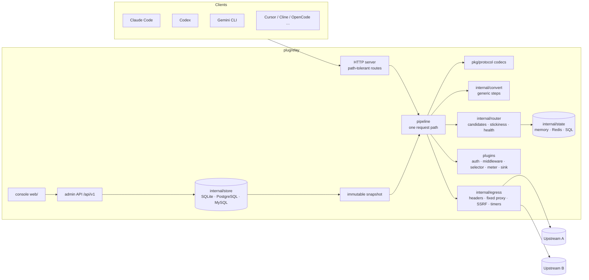
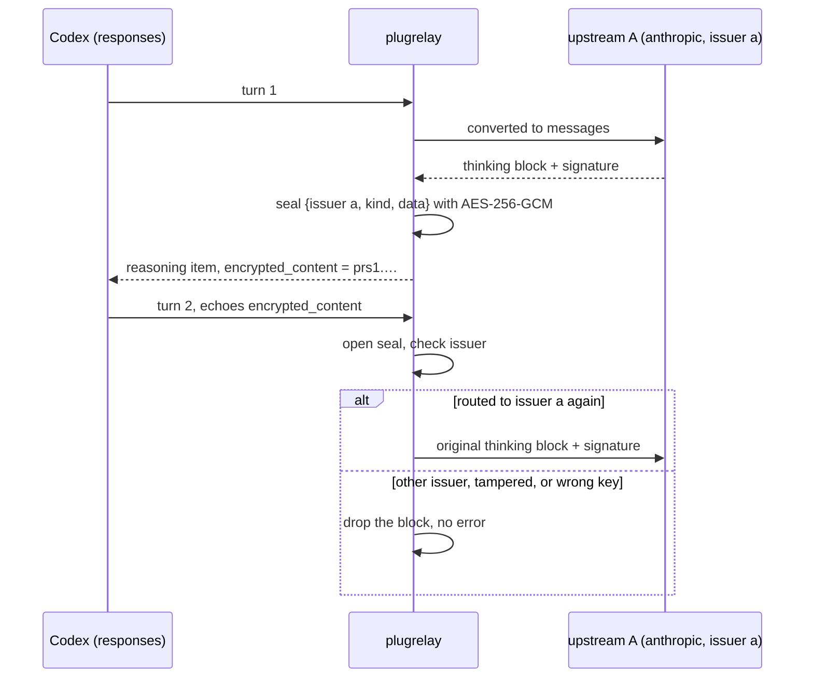

# Architecture

English | [简体中文](architecture.zh-CN.md)

How a request moves through plugrelay and which package owns each decision.
Terms are defined once in [`CONTEXT.md`](../CONTEXT.md); long-lived decisions
are in [`docs/adr/`](adr/). Code is the source of truth — every section names
the package to read.

- [Big picture](#big-picture)
- [Request lifecycle](#request-lifecycle)
- [Processing tiers](#processing-tiers)
- [IR and capabilities](#ir-and-capabilities)
- [Generic conversion steps](#generic-conversion-steps)
- [Private-state sealing](#private-state-sealing)
- [Routing, stickiness and failure verdicts](#routing-stickiness-and-failure-verdicts)
- [Streaming, keepalive and timeouts](#streaming-keepalive-and-timeouts)
- [Egress rules](#egress-rules)
- [Storage layers](#storage-layers)
- [Plugin system: features, modules, extensions](#plugin-system-features-modules-extensions)
- [Hard rules and where they are enforced](#hard-rules-and-where-they-are-enforced)

## Big picture



The core knows no specific upstream and names no client. Client protocols are
codecs in `pkg/protocol/<name>`; upstreams are provider plugins, mostly
declarative manifests in `manifests/`.

Wiring: `internal/app` builds everything from relay.yaml; `internal/server`
dispatches `/healthz`, `/readyz`, `/metrics`, protocol routes, WebSocket
upgrades (`/v1/realtime`, `/v1/responses`), native passthrough (`/native/`),
the MCP gateway (`/mcp`, `internal/mcp`, which
reaches MCP servers through the core egress), the admin API (`internal/admin`, under `/api/v1`),
plugins' HTTP routes (`/api/plugins/<id>/`) and the console.

## Request lifecycle

Every client protocol and every upstream go through
`pipeline.ServeProtocol` (`internal/pipeline/`), so logging, billing, retries
and error rendering happen once. The step list in the package doc of
`internal/pipeline/doc.go` is authoritative; the diagram follows it. Three
paths are outside it. Native passthrough (`pipeline.ServeNative`, off by
default) forwards bytes to a named upstream with a credential picked by
`Router.PlanUpstream` and the core egress, runs no plugins, bills nothing and
records one log entry ([clients.md](clients.md#native-passthrough)). The
batch APIs (`pipeline.ServeBatch`) place a new file or batch with
`Router.Plan` on an endpoint declaring `batches`, record its credential and
owner in the store, send every later call for it to that credential, and
bill its results through the meter when they are first read
([clients.md](clients.md#batches)). WebSocket sessions
(`pipeline.ServeWebSocket`: `/v1/realtime`, the Responses WebSocket mode)
pick a credential with `Router.Plan` (an endpoint declaring `realtime`) or
`Router.PlanUpstream` (`responses_websocket`), hold its concurrency slot for
the session, run the request plugins on a body-less call (per session, or
per `response.create`), dial the upstream WebSocket through the core egress
before accepting the client, relay messages both ways, and hold for and
settle each response with the meter as its own log entry
([clients.md](clients.md#realtime-and-websocket)).
The HTTP server does not close hijacked connections on shutdown, so it
cancels their context when shutdown starts.

```mermaid
sequenceDiagram
    autonumber
    participant C as Client
    participant P as pipeline
    participant H as plugins (auth, middleware, meter)
    participant R as router + selector
    participant V as provider plugin
    participant U as upstream
    participant S as sinks
    C->>P: POST /v1/messages (any client protocol)
    P->>P: sniff model, stream, session hints; resolve session id
    P->>P: decode once into IR → needs (read-only)
    P->>H: authenticate → OnRequest hooks (config order) → meter.Reserve
    H-->>P: pass / reply / reject
    P->>R: plan candidates (groups, capabilities, stickiness, health, caps)
    R-->>P: ordered candidates (selector may only reorder)
    loop until one succeeds, verdict allows retry, nothing sent to client yet
        P->>H: OnAttempt (per attempt)
        P->>V: Prepare (auth + owned headers)
        P->>U: send via egress (passthrough / patch / convert)
        alt success
            U-->>P: response / stream
        else failure before first content event
            U-->>P: error
            P->>V: Classify → Verdict
            P->>R: report verdict (cooldown / quarantine / breaker), re-plan excluding tried
        end
    end
    P-->>C: stream as it arrives (read-only decoder: usage, terminal event, seals)
    P->>H: cost every sent attempt, charge delivered one, settle or refund once; OnFinish (reverse)
    P->>R: bind session for stickiness
    P--)S: queue record (bounded, async)
```

Defaults worth knowing (`internal/pipeline/deps.go`): at most 4 attempts per
request, keepalive every 15 s, keepalives start after 5 s without upstream
output, a per-event hook budget of 50 ms.

A JSON request body that repeats a key in any object is refused with 400
`duplicate_key` before anything else reads it; so is each line of an OpenAI
batch input file and an Anthropic batch body, and a WebSocket client event
gets the same error. The relay reads a key's first occurrence and most
upstreams its last, so a repeated `model` or `stream` would be checked,
routed and billed as one request and served as another (`duplicateKey` in
`internal/pipeline/websocket.go`).

## Processing tiers

Each attempt picks the lowest tier that works (`plugin.Tier`):

| tier | what happens to the body | when |
|-|-|-|
| `passthrough` | not a byte changes; a read-only stream decoder watches usage and the terminal event | endpoint speaks the client's protocol, same model name, no plugin edits |
| `patch` | named fields edited in place with sjson; field order, `system` arrays and `cache_control` stay | model rename, stale private state removed after an issuer change, output-limit field rename, `stream_options.include_usage` added (below), edits declared in a plugin's `Mutates` |
| `convert` | decode to IR → generic steps → encode for the target | the endpoint speaks another protocol |

A streamed OpenAI chat or completions request without
`stream_options.include_usage` gets it set, so the upstream reports usage
instead of leaving billing to a character estimate; the usage-only last
chunk this adds is dropped before it reaches the client, which still gets
the stream it asked for (`patchBody` in `internal/pipeline/body.go`).

Same-protocol patching uses the codec's `SetModel` and `StripOpaque`
(`pkg/protocol/codec.go`). Plugins edit in the patch tier through
`plugin.BodyMutator` and only on paths they declared; in the convert tier they
edit the IR in `OnAttempt`. The tier of every attempt is in the request log.

## IR and capabilities

- `pkg/ir` is the union of what the protocols express (`anthropic`,
  `openai-chat`, `openai-responses`, `gemini`, and the prompt-only
  `openai-completions`), shaped like
  Anthropic content blocks; streams become `ir.Event`s. Anything without a
  slot is kept verbatim in `Extra` so a same-protocol round trip is lossless.
- Codecs only move fields. They never decide what to drop and must not name
  products in their logic (package doc of `pkg/protocol/codec.go`).
- Each codec declares `ir.Capabilities`; each endpoint narrows them (manifest
  `capabilities`). The effective set is the intersection.
- Decoding yields `ir.Needs`. `convert.Assess` compares needs with effective
  capabilities and grades the endpoint `lossless`, `lossy`, `discouraged`
  (two or more major losses; excluded unless an admin allows it) or
  `impossible` (never routed). Grading rules: package doc of
  `internal/convert/convert.go`.
- Media operations have their own codecs (`openai-embeddings`,
  `gemini-embeddings`, `openai-images`, `openai-audio`, `rerank`,
  `cohere-rerank`, the upstream-only `tei-rerank`), all
  `Capabilities.MediaOnly`: a request decodes to `Needs.Modality` and is
  routed only to endpoints whose capabilities declare that operation; a text
  request never reaches them. Embeddings convert across protocols through
  `ir.Embed` / `Response.Embeddings`, rerank through `ir.Rerank` /
  `Response.Ranks` (the client codec applies `top_n` and fills documents
  from the request); images and audio are passthrough only,
  their metered facts in `ir.MediaUnits`. Multipart upload routes
  (`Route.Upload`) are not read by the server: `internal/pipeline/upload.go`
  reads the form fields before the first file, streams the parts to one
  upstream (or replays a temporary copy when the model field comes after the
  file), and a `protocol.BodyStreamer` response (speech audio, event streams)
  is copied to the client as it arrives.
- A prompt-only protocol (`Capabilities.PromptOnly`: `openai-completions`)
  only receives requests from another prompt-only client; going the other
  way, the prompt becomes one user message (lossy). A `suffix`
  (`Needs.FillInMiddle`) is served only by endpoints declaring
  `fill_in_middle`.

Usage is normalized into five non-overlapping buckets plus reasoning and the
upstream's raw usage (`ir.Usage` in `pkg/ir/response.go`); media operations
add units (images, audio milliseconds, characters, rerank search units)
priced per unit.

## Generic conversion steps

`convert.Request` runs only the steps whose capabilities differ, and records
each in an `ir.Diagnostic` (steps, dropped fields, missing needs). No step
mentions a client or upstream (`TestNoProductNames`).

| step | runs when | does |
|-|-|-|
| cache (`cache.go`) | cache modes differ | target wants explicit breakpoints and the request has none → place them on the last system block and the last two messages; 1h TTL shortened if unsupported; keyed target → session id fills the cache key; no caching → breakpoints removed |
| tools (`tools.go`) | target lacks a tool kind | freeform tools wrapped as single-string function tools and unwrapped on the way back; namespaced tools flattened to `<ns>__<name>` (hashed when that name is taken) and mapped back; server tools removed when only offered, or the endpoint is impossible when required (forced by tool_choice or mid-call); server tool history rewritten as text; deferred tools expanded |
| private state (`opaque.go`) | history or response carries opaque state | see [sealing](#private-state-sealing) |
| parameters (`params.go`) | parameter systems differ | output-limit field renamed; effort ⇄ thinking budget via a fixed table (minimal 1024 … max 64000), nearest value when out of range; unsupported params removed |
| content (`content.go`) | target lacks a content form | images inside tool results moved to separate blocks; unsupported content makes the endpoint impossible |
| usage (`usage.go`) | always | estimates usage when the upstream reported none (marked `estimated`) |

The response side (`response.go`) restores wrapped and renamed tools, seals new opaque
state and renders events for the client.

## Private-state sealing

Decision record: [ADR-0003](adr/0003-seal-private-state-with-master-key.md).



- Seals carry `ir.SealPrefix` (`prs1.`), then base64url of nonce ‖ ciphertext;
  the key is derived from the master key with HKDF (`internal/seal/seal.go`).
- A protocol can carry seals only if it has an echo field
  (`Capabilities.EchoFields`: `redacted_thinking`, `encrypted_content`,
  `thought_signature`). OpenAI chat has none, so the state is lost there and
  the diagnostic says so.
- Same-protocol passthrough never seals. If the issuer changes, the patch
  tier strips stale state with `StripOpaque`.

## Routing, stickiness and failure verdicts

`internal/router` builds candidates from an immutable `router.Table`; live
health lives in `internal/state` so every node sees the same picture. Read
`Router.Plan` in `internal/router/plan.go` for the exact order.

1. Resolve the name: a model is its own routes; a preset is each of its
   models the caller may use, one fallback level each, in the preset's
   order (only when the client asked for the preset — the relay never swaps
   a model on its own).
2. Drop routes outside the caller's group, disabled upstreams, endpoints
   graded impossible (or discouraged unless allowed), upstreams with an open
   breaker, credentials that are quarantined, cooling (whole credential or
   this model only), at their concurrency cap, owned by another user
   (`personal`), or already tried in this request. An upstream whose
   manifest makes the key optional (`auth.key_optional`) and
   that has no credentials at all is keyless: it is planned as one shared
   credential with id `""`, sent no auth header. Any other upstream without
   a usable credential has no route (`router.Upstream.Keyless`).
3. Within an upstream: same-protocol endpoints first, then better fidelity,
   then lower latency. Credentials recently used by this user first, then
   fewer in flight.
4. Order routes by fallback level, then priority (higher first), then by
   their best endpoint as in step 3; new sessions are split by weight among
   equally fitting routes, existing sessions are not.
5. A valid turn token, then a valid session binding, go first regardless of
   priority. The routing strategy (`selector.routing`, or a preset's own
   pick strategy) may reorder, never add
   ([configuration](configuration.md#routing-models-and-presets)).

Stickiness follows cache value: a binding stays valid only while the last
turn read or wrote the prompt cache, for 5 minutes (1 hour when the 1h cache
was written). Each user is kept on at most 3 recent credentials for 24 hours.
Turn tokens (Codex's same-turn header) expire after 6 hours.

When an attempt fails, the provider returns a `plugin.Verdict`; the core only
executes it (`internal/router/health.go`). Causes `request`, `transient` and
`content` never change the credential, whatever action the verdict asks for.
Only `transient` failures count toward the upstream breaker (5 failures
within a minute open it for 30 s, then one probe). A cooldown without an end
time uses backoff: 30 s, doubling per strike, capped at 30 min.

The generic provider's built-in verdicts
(`plugins/provider/compatible/classify.go`), applied after a manifest's own
`errors` rules:

| upstream answer | cause | credential | retry |
|-|-|-|-|
| no response / timeout / 408, 409, 5xx | `transient` | keep | next candidate |
| content-filter signal or code | `content` | keep | none, anywhere |
| 400/401/403 that reads like a suspended account | `banned` | quarantine | none |
| 400/403 citing usage policy or abuse; other 403 | `unknown` | quarantine (conservative) | none |
| 403 region not supported | `transient` | keep | next |
| 402, `insufficient_*`, quota signal | `quota` | cooldown until the upstream's reset | next |
| 401 | `auth_expired` | refresh if the provider can, else cooldown | next |
| 429, 529, overloaded 503 | `rate_limit` | cooldown for this model only (retry-after or reset) | next |
| context too long | `request` | keep | none (client compacts) |
| 404, 405 | `request` | keep | next |
| other 4xx | `request` | keep | none |

A 404/405/501 about the path itself (empty body, a server's plain page, a
bare "Not Found", "invalid URL"; never one naming a model, deployment or
other resource) also marks that endpoint as not serving the operation for an
hour, in shared state; plans leave it out while another candidate remains
(`internal/pipeline/unserved.go`). A generic OpenAI-compatible server without
`/completions` costs one 404, not one per request.

When no candidate is left, the plan error kind (`no_route`, `impossible`,
`cooling`, `busy`, `exhausted`) becomes an error in the client's own protocol
format.

## Streaming, keepalive and timeouts

- Bytes are forwarded as they arrive. Output before the first content event
  is held so a retry can start clean; after the first content event the
  request never moves to another upstream.
- Keepalives (Anthropic `ping`, SSE comment lines elsewhere) start after 5 s
  without upstream output and repeat every 15 s while idle. They are not
  content. Once a keepalive committed HTTP 200, later failures can only be
  reported as a stream error event.
- A stream that ends without its protocol's terminal event gets the client
  protocol's error event, never a clean end. It is billed at least for the
  output received: when the usage reported so far is lower than an estimate
  from the characters relayed, the estimate is used and the usage marked
  `estimated` (`settleUsage` in `internal/pipeline/cost.go`).
- Timers per attempt (`internal/egress/timers.go`): connect (off unless an
  upstream sets it), first byte (2 min), idle between chunks (5 min), total
  (30 min). Defaults and per-upstream overrides in
  [configuration](configuration.md#egress).
- `pkg/sse` is the only SSE parser; an oversized event is an error, never
  silently dropped.

## Egress rules

All upstream traffic leaves through `internal/egress`:

- **Headers out** (`OutboundHeaders`): credentials, account selectors, framing,
  hop-by-hop and client-address headers (`Authorization`, `X-Api-Key`,
  `X-Goog-Api-Key`, `Api-Key`, `OpenAI-Organization`, `OpenAI-Project`,
  `Cookie`, `Host`, `Content-Length`, `Accept-Encoding`, `Forwarded`, `Via`,
  `X-Real-IP` and similar) are never forwarded; headers the provider owns
  carry only the provider's values. Same protocol: everything else is
  forwarded verbatim (so new `anthropic-beta` values work). Across protocols:
  only headers the target needs. Nothing is added except a `User-Agent` when
  none survives.
- **Headers back** (`InboundResponseHeaders`): everything except hop-by-hop,
  `Set-Cookie`, `Alt-Svc` and stale framing headers — so `retry-after`,
  `x-should-retry`, rate-limit headers and request ids reach the client.
- **Fixed egress**: each credential has one proxy: its own, else its
  upstream's, else direct. If the proxy is down the attempt fails; it never
  falls back to direct. Calls a provider makes itself take the same egress:
  `Outgoing.Client` during an attempt, `Host.ClientFor` for model sync,
  quota probes and refreshes ([plugins](plugins.md)).
- **Extra headers** an upstream configures go through `SetExtraHeaders`:
  never a provider-owned or dangerous header.
- **SSRF guard**: every dialed address is checked; private and loopback
  ranges are blocked unless listed in `egress.allow_private_cidrs` or the
  upstream is flagged to allow private addresses; the IPv4 inside a NAT64
  or 6to4 address is checked too. Redirects are not followed.

## Storage layers

Decision record: [ADR-0004](adr/0004-two-level-pluggable-storage.md).

| layer | holds | drivers | package |
|-|-|-|-|
| bootstrap | listen address, master key, store/state choice | `relay.yaml` + `PLUGRELAY_*` env; never written by plugrelay | `internal/config` |
| store | users, groups, keys, upstreams, credentials (encrypted), models, routes, presets, prices, site settings, feature states, extension configs, layered plugin settings, manifests, request log with hourly rollups, audit log, plugin KV, batch objects (where each batch and file lives, its owner, whether billed), notification channels (secrets sealed) and the notification log, sign-in identities and second factors, price-sync suggestions, the sell kit's balance ledger, redeem codes, subscriptions, payment orders, coupons and referrals | SQLite (default, pure Go), PostgreSQL, MySQL | `internal/store` |
| state | session bindings, cooldowns, breakers, in-flight slots, rate windows, locks | memory (single node), SQL (single node, survives restarts), Redis (clusters) | `internal/state` |

Every routing-relevant write bumps a version counter in the same transaction;
the core polls it and rebuilds an immutable snapshot only when it changed.
Requests in flight finish on the snapshot they started with. `plugrelay
export` / `apply` round-trip business data as YAML
([configuration](configuration.md#business-data-as-yaml)).

`internal/app` polls the version every 2 s (`PollEvery`).

## Plugin system: features, modules, extensions

Details and how-tos: [plugins.md](plugins.md); the operator's view:
[configuration](configuration.md#features). In short:

- Policy is plugins, attached to extension points: `provider`, `auth`,
  `middleware`, `selector`, `meter`, `sink`, `job`, `admin`
  (`pkg/plugin/points.go`). Plugins add no console UI; the console has fixed
  pages and shows them by feature.
- What runs is decided by `internal/features`: core modules always run; a
  feature is one switch and one settings form over built-in modules, which
  run exactly while it is on (state in the store); every other plugin (an
  external process, a Go plugin linked into a custom build) is an extension,
  switched one by one. `App.states` (`internal/app/plugins.go`) resolves
  this, then `Requires`, then test mode, on every reload.
- Three ways to write one, same points and settings to the core: a YAML
  manifest (providers only), an external process speaking JSON-RPC over
  stdio ([ADR-0011](adr/0011-external-plugins-json-rpc-go-sdk.md)), or
  built-in Go registered at compile time.
- Call order: auth, `OnRequest`, selector, `meter.Reserve`, `OnFinish` and
  settle/refund once per request; `OnAttempt` once per attempt. Pre-hooks
  run in configured order, post-hooks in reverse and only for plugins whose
  pre-hook ran. Any pre-hook may answer directly. `OnEvent` is built-in only
  with a per-event time budget.
- On plugin malfunction the declared `FailPolicy` applies: `closed` for auth,
  meter and middleware by default, `open` for sinks and jobs.

## Hard rules and where they are enforced

The rules every change must keep, and the tests that pin each one.

| # | rule | enforced in | tests |
|-|-|-|-|
| 1 | a stream ends with its protocol's terminal event; a mid-stream failure becomes the protocol's error event, never a clean end | `internal/pipeline` (stream.go), codec stream encoders | `TestKeepaliveThenFailureIsStreamError`, `TestUpstreamCutAfterContentRefunds` (internal/pipeline); `TestStreamDecodeIncomplete` (anthropic, openairesponses) |
| 2 | no other upstream after the first content event; keepalives are not content | `internal/pipeline` | `TestNoRetryAfterContent`, `TestRetryOn429ThenSuccess`, `TestKeepaliveBeforeFirstByteThenRetry` |
| 3 | same-protocol endpoints first; lowest tier; passthrough is byte-exact | `internal/router/plan.go`, `internal/pipeline` | `TestSameProtocolPreferred` (router); `TestPassthroughByteExact`, `TestEmbeddingsPassthroughByteExact` (pipeline) |
| 4 | no client or upstream name in the generic steps | `internal/convert` | `TestNoProductNames` |
| 5 | endpoints that cannot meet a need are not routed; 400 only when none is left | `internal/convert` (Assess), `internal/router` | `TestAssessMatrix`, `TestAdmits`, `TestAssessMedia` (convert); `TestCapabilityFiltering` (router); `TestMediaCapabilityMissing` (pipeline) |
| 6 | `system` arrays, `cache_control` and field order untouched in passthrough and patch | codecs' `SetModel`/`StripOpaque`, `internal/pipeline` | `TestPassthroughByteExact`, `TestPatchChangesOnlyModel` (pipeline); `TestSetModelByteExact` (openaichat) |
| 7 | private state only goes back to its issuer; sealed across protocols; unreadable seals dropped silently | `internal/seal`, `internal/convert/opaque.go` | `TestSealedReasoningRoundTrip` (pipeline); `TestOpaqueHistory`, `TestOpaqueResponseRoundTrip` (convert); `TestTamper`, `TestWrongKey` (seal) |
| 8 | relay-made errors use the client protocol's native format and signals | codecs' `EncodeError`, `internal/pipeline/errors.go` | `TestRelayErrorsAreNative`, `Test429CrossProtocolNative` |
| 9 | upstream error text, status, `retry-after`, `x-should-retry`, limit headers reach the client | `internal/egress/headers.go`, provider `Classify` | `Test429PassthroughVerbatim` (pipeline); `TestClientErrPassthrough` (compatible); `TestInboundResponseHeaders` (egress) |
| 10 | first-byte / idle / total timeouts; keepalive every 15 s when idle, starting after 5 s | `internal/egress/timers.go`, `internal/pipeline` | `TestTimers` (egress); `TestFirstByteTimeout`, `TestUpstreamTimeoutsOverrideDefaults`, `TestKeepaliveBeforeFirstByteThenRetry` (pipeline) |
| 11 | session ids are stable; bindings record the id actually sent upstream | `internal/pipeline`, `internal/router/session.go` | `TestSessionIDStableAcrossTurns` (pipeline); `TestStickinessWindow` (router) |
| 12 | usage is five buckets plus raw; Anthropic total input = input + cache read + cache writes | codecs, `ir.Usage.TotalInput` | `TestUsageBucketsAcrossCodecs` (pkg/protocol: every codec, response, stream and client encoding); `TestUsageMapping` (openaichat), `TestUsageFallback` (anthropic) |
| 13 | an oversized SSE event is an error, never dropped | `pkg/sse` | `TestReaderMaxEventSize` (sse); `oversized_event` scenario of `pkg/plugin/plugintest` (`TestFakeProviderAllProtocols`) |
| 14 | provider-owned headers carry only provider values; dangerous headers never forwarded; no proxy headers added | `internal/egress/headers.go`, providers' `Prepare` | `TestOutboundHeaders`, `TestSetExtraHeaders` (egress); `TestPrepareOwnsHeaders` (compatible); `TestUpstreamExtraHeaders` (pipeline) |
| 15 | a credential's egress is fixed, for provider-made calls too; a dead proxy fails, never falls back to direct | `internal/egress/client.go`, `internal/egress/plugin_clients.go`, `plugin.Outgoing.Client`, `Host.ClientFor` (`internal/app/plugins.go`) | `TestProxyFixedNoFallback`, `TestPluginClients` (egress); `TestUpstreamProxy`, `TestProviderCallsUseAttemptEgress` (pipeline); `TestBackgroundCallsHonourProxy` (internal/app); `TestSendUsesAttemptEgress` (bedrock); `TestTokenExchangeUsesCredentialEgress` (vertex); `TestBackgroundCallsUseCredentialEgress` (compatible); `TestHostHTTPCredentialEgress` (extplugin) |
| 16 | suspected bans quarantine at once and stay (a keyless self-hosted upstream, with no credential to restore, is only cooled down and nothing is persisted); content rejections are retried nowhere; uncertain → conservative | providers' `Classify`, `internal/router/health.go`, manifest validation | `TestHardRules16And17` (compatible); `TestValidationHardRules` (manifest); `TestCooldownAndQuarantine`, `TestKeylessUpstream` (router); `TestKeylessUpstreamRoutes` (internal/app); `TestContentViolationNotRetried` (pipeline) |
| 17 | failures that are not the credential's fault never change its state | `internal/router/health.go` | `TestCooldownAndQuarantine` (router); `TestHardRules16And17` (compatible) |
| 18 | personal credentials serve only their owner | `internal/router/plan.go` | `TestPersonalCredentialIsolation` |
| 19 | every attempt that reached an upstream is costed; the caller is charged per meter policy, by default only the delivered attempt | `internal/pipeline/cost.go`, `meter.*` | `TestCostRecordedForFailedSentAttempt`, `TestMeterSettleOrRefundExactlyOnce` (pipeline); `TestSettleRefundIdempotent` (quota) |
| 20 | a `strictest` setting is never loosened by a lower layer unless the key is exempted; an invalid stored layer of an allowlist allows nothing, never reads as no restriction | `internal/settings` | `TestHardRule20StrictestNeverLoosens`, `TestInvalidLayerFailsClosed` (settings); `TestGroupAllowlistInvalidValueDeniesAll` (internal/app) |
| 21 | model sync: failed or empty listing changes nothing; vanished models are disabled, never deleted; manual models untouched | `plugins/job/modelsync` | `TestRule21` |
| 22 | request bodies are not logged by default; test mode turns off plugins that report off the box | `plugins/sink/requestlog`, `plugin.Info.ReportsOffBox`, `plugins/builtin` (`ForTestMode`), `internal/app/plugins.go` (`PLUGRELAY_TEST_MODE`) | `TestBodyLogging` (requestlog); `TestForTestMode` (builtin); `TestTestModeDropsOffBoxPlugins` (internal/app) |
| 23 | built-in plugins reach upstreams only through the core egress; charges change only through `meter`, and each prepaid-ledger write only through the sell-kit plugin that owns it; an external plugin crash never takes the relay down | `pkg/plugin` (`Host.HTTPClient`, `Host.ClientFor`, `Outgoing.Client`), `internal/pipeline/sinks.go` (each sink gets its own record copy), `internal/extplugin` supervision | `TestPluginsUseCoreEgress`, `TestPluginsCannotChangeBalances` (plugins/boundary_test.go); `TestSinkCannotChangeCharge` (pipeline); `TestCrashRestart`, `TestDownCallsFailFast` (extplugin) |
| 24 | the console only calls the public admin API (and, on the billing pages, the sell kit's documented plugin routes) | `api/openapi.yaml`, `web/` | `internal/admin/openapi_test.go` checks the server against the spec; `scripts/lint.sh` regenerates the console's typed client from the spec and fails on drift, and `npm run typecheck` rejects calls to paths the spec lacks; `plugins/builtin/console_routes_test.go` checks that every plugin route the billing pages call (`web/src/features/billing/`) is one a sell-kit plugin registers, with its method |
| 25 | credential and upstream state shown in the console is the router's live state | `router.Live` (`internal/router/health.go`), admin `Runtime.Live` (`internal/admin/credentials.go`), table installed on every reload (`internal/app/runtime.go`) | `TestConsoleShowsRouterLiveState` (internal/app) |
