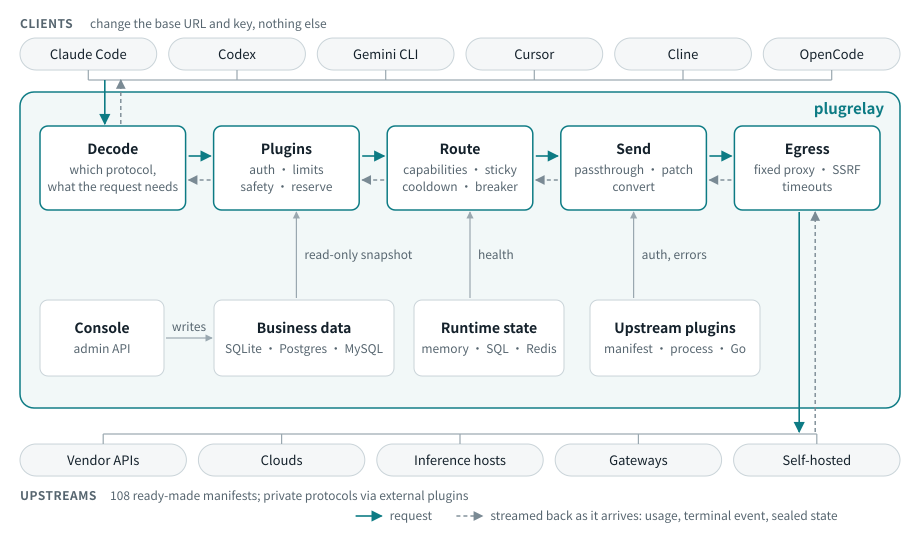
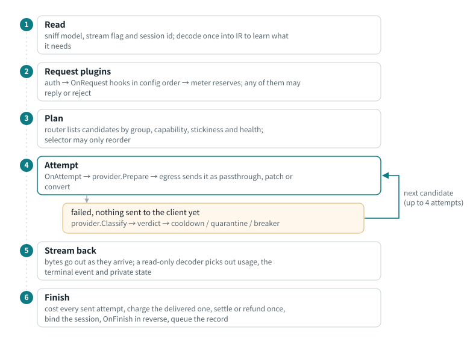
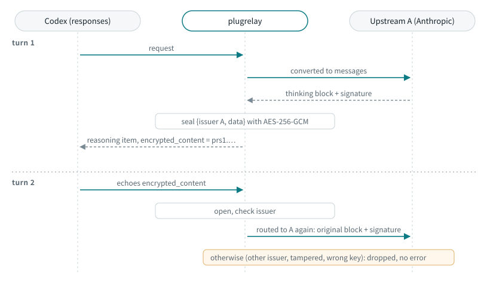

# Architecture

English | [简体中文](architecture.zh-CN.md)

How a request moves through plugrelay and which package decides what. Terms
are defined in [`CONTEXT.md`](../CONTEXT.md), long-lived decisions in
[`docs/adr/`](adr/). When this page and the code disagree, the code wins.

- [Big picture](#big-picture)
- [Request lifecycle](#request-lifecycle)
- [Processing tiers](#processing-tiers)
- [IR and capabilities](#ir-and-capabilities)
- [Generic conversion steps](#generic-conversion-steps)
- [Private-state sealing](#private-state-sealing)
- [Routing, stickiness and failure verdicts](#routing-stickiness-and-failure-verdicts)
- [Streaming, keepalive and timeouts](#streaming-keepalive-and-timeouts)
- [Egress rules](#egress-rules)
- [Storage layers](#storage-layers)
- [Plugin system: features, modules, extensions](#plugin-system-features-modules-extensions)
- [Hard rules and where they are enforced](#hard-rules-and-where-they-are-enforced)

## Big picture

The core names no client and no upstream. Client protocols are codecs in
`pkg/protocol/<name>`; upstreams are provider plugins, mostly YAML manifests
in `manifests/`.

`internal/app` wires everything from relay.yaml. `internal/server` mounts the
protocol routes, WebSocket upgrades, `/native/`, the MCP gateway (`/mcp`), the
admin API (`/api/v1`), plugin routes (`/api/plugins/<id>/`), health and
metrics endpoints, and the console.

## Request lifecycle

Every client protocol and every upstream goes through `pipeline.ServeProtocol`,
so logging, billing, retries and error rendering live in one place. The
authoritative step list is the package doc in `internal/pipeline/doc.go`.

Defaults (`internal/pipeline/deps.go`): 4 attempts per request; keepalives
start after 5 s of upstream silence and repeat every 15 s; 50 ms per stream
event hook.

Three paths sit outside the main one:

| path | entry | what differs |
|-|-|-|
| native passthrough (off by default) | `pipeline.ServeNative` | bytes go to a named upstream as they are; no plugins, no billing, one log entry |
| batches | `pipeline.ServeBatch` | a new file or batch is placed on an endpoint declaring `batches`; later calls go to the same credential; results are billed when first read |
| WebSocket | `pipeline.ServeWebSocket` | the session holds one concurrency slot; request plugins run per session or per `response.create`; each response is reserved, settled and logged on its own |

Details: [native passthrough](clients.md#native-passthrough), [batches](clients.md#batches), [WebSocket](clients.md#realtime-and-websocket).

A JSON body that repeats a key in any object is refused with 400
`duplicate_key` before anything reads it. The relay reads a key's first
value and most upstreams its last, so a doubled `model` or `stream` would be
routed and billed as one request and served as another. The same check
covers batch input lines and WebSocket client events.

## Processing tiers

Each attempt picks the lightest tier that works (`plugin.Tier`):

| tier | body | when |
|-|-|-|
| `passthrough` | not a byte changes; a read-only decoder watches usage and the terminal event | endpoint speaks the client's protocol, same model name, no plugin edits |
| `patch` | named fields edited in place (sjson); field order, `system` arrays and `cache_control` untouched | model rename, stale private state removed, output-limit field rename, `stream_options.include_usage` added, edits a plugin declared in `Mutates` |
| `convert` | decode to IR → generic steps → encode for the target | the endpoint speaks another protocol |

Streamed OpenAI chat and completions requests get `include_usage` so the
upstream reports real usage; the extra usage-only chunk is dropped before
the client sees it (`patchBody` in `internal/pipeline/body.go`).

Same-protocol patches use the codec's `SetModel` and `StripOpaque`. Plugins
edit in the patch tier through `plugin.BodyMutator`, only on paths they
declared; in the convert tier they edit the IR in `OnAttempt`. The request
log records the tier of every attempt.

## IR and capabilities

- `pkg/ir` covers what all the protocols can express, shaped like Anthropic
  content blocks; streams become `ir.Event`s. Fields without a slot go to
  `Extra`, so a same-protocol round trip loses nothing.
- Codecs only move fields. They never decide what to drop and never name a
  product.
- Each codec declares `ir.Capabilities`; each endpoint narrows them in its
  manifest. The effective set is the intersection.
- Decoding yields `ir.Needs`. `convert.Assess` grades each endpoint against
  them: `lossless`, `lossy`, `discouraged` (two or more major losses; skipped
  unless an admin allows it) or `impossible` (never routed). Rules: package
  doc of `internal/convert/convert.go`.
- Media codecs (embeddings, images, audio, rerank) are `MediaOnly`: their
  requests route only to endpoints declaring that operation, and text
  requests never reach them. Embeddings and rerank convert across formats;
  images and audio are passthrough only. Multipart uploads are streamed to
  the upstream without the server reading the body
  (`internal/pipeline/upload.go`).
- `openai-completions` is prompt-only: it takes requests only from
  completions clients. A `suffix` (fill-in-the-middle) goes only to
  endpoints declaring `fill_in_middle`.

Usage is five non-overlapping buckets plus reasoning and the upstream's raw
numbers (`ir.Usage`); media adds per-unit counts (images, audio ms,
characters, rerank search units).

## Generic conversion steps

`convert.Request` runs only the steps where capabilities differ and records
each in an `ir.Diagnostic`: steps run, fields dropped, needs unmet. No step
names a client or upstream (`TestNoProductNames`).

| step | runs when | does |
|-|-|-|
| cache (`cache.go`) | cache modes differ | add breakpoints on the last system block and last two messages when the target needs them; shorten an unsupported 1 h TTL; fill a cache key from the session id; remove breakpoints when the target has no cache |
| tools (`tools.go`) | target lacks a tool kind | wrap freeform tools as one-string function tools and unwrap on return; flatten namespaced tools to `<ns>__<name>`; drop server tools that are only offered, mark the endpoint impossible if one is required; rewrite server-tool history as text; expand deferred tools |
| private state (`opaque.go`) | opaque state in history or response | see [sealing](#private-state-sealing) |
| parameters (`params.go`) | parameter systems differ | rename the output-limit field; map effort ⇄ thinking budget by a fixed table (minimal 1024 … max 64000); drop unsupported params |
| content (`content.go`) | target lacks a content form | move images out of tool results; unsupported content makes the endpoint impossible |
| usage (`usage.go`) | always | estimate usage when the upstream reports none (marked `estimated`) |

On the way back, `response.go` restores wrapped and renamed tools, seals new
private state and renders events for the client.

## Private-state sealing

Decision: [ADR-0003](adr/0003-seal-private-state-with-master-key.md).

- A seal is `prs1.` followed by base64url(nonce ‖ ciphertext), under a key
  derived from the master key with HKDF (`internal/seal`).
- Seals ride in a protocol's echo fields (`redacted_thinking`,
  `encrypted_content`, `thought_signature`). OpenAI chat has none, so the
  state is lost there and the diagnostic says so.
- Same-protocol passthrough never seals. When the issuer changes, the patch
  tier strips stale state with `StripOpaque`.

## Routing, stickiness and failure verdicts

`internal/router` plans from an immutable `router.Table`; live health sits in
`internal/state` so every node sees the same thing. The exact order is in
`Router.Plan` (`internal/router/plan.go`):

1. **Resolve the name.** A model is its own routes. A preset expands to its
   models, one fallback level each, but only when the client asked for the
   preset; the relay never swaps a model on its own.
2. **Drop** routes outside the caller's group, disabled upstreams, endpoints
   graded impossible (or discouraged), upstreams with an open breaker, and
   credentials that are quarantined, cooling down, at their concurrency cap,
   someone else's personal credential, or already tried. An upstream whose
   manifest allows no key (`auth.key_optional`) and has no credential is
   planned as one shared keyless credential.
3. **Inside an upstream:** same-protocol endpoints first, then higher
   fidelity, then lower latency. Credentials this user used recently first,
   then fewer in flight.
4. **Across routes:** fallback level, then priority, then best endpoint.
   Weights split only new sessions.
5. **Stickiness wins:** a valid turn token, then a valid session binding, go
   first regardless of priority. The routing strategy may reorder the list
   but never add to it ([configuration](configuration.md#routing-models-and-presets)).

Stickiness follows cache value. A binding lasts only while the last turn read
or wrote the prompt cache: 5 minutes, or 1 hour after a 1 h cache write. A
user stays on at most 3 recent credentials for 24 hours. Codex turn tokens
expire after 6 hours.

On failure the provider returns a `plugin.Verdict` and the core carries it
out (`internal/router/health.go`). Causes `request`, `transient` and
`content` never touch the credential. Only `transient` counts toward the
breaker: 5 in a minute opens it for 30 s, then one probe. A cooldown with no
end time backs off from 30 s, doubling up to 30 min.

Built-in verdicts of the generic provider
(`plugins/provider/compatible/classify.go`), after a manifest's own `errors`
rules:

| upstream answer | cause | credential | retry |
|-|-|-|-|
| no response / timeout / 408, 409, 5xx | `transient` | keep | next candidate |
| content-filter signal or code | `content` | keep | none, anywhere |
| 400/401/403 that reads like a suspended account | `banned` | quarantine | none |
| 400/403 citing usage policy or abuse; other 403 | `unknown` | quarantine (to be safe) | none |
| 403 region not supported | `transient` | keep | next |
| 402, `insufficient_*`, quota signal | `quota` | cooldown until the upstream's reset | next |
| 401 | `auth_expired` | refresh if possible, else cooldown | next |
| 429, 529, overloaded 503 | `rate_limit` | cooldown for this model only | next |
| context too long | `request` | keep | none (client compacts) |
| 404, 405 | `request` | keep | next |
| other 4xx | `request` | keep | none |

A 404/405/501 about the path itself (not about a model or resource) also
marks that endpoint as not serving the operation for an hour, so an
OpenAI-compatible server without `/completions` costs one 404, not one per
request (`internal/pipeline/unserved.go`).

When no candidate is left, the reason (`no_route`, `impossible`, `cooling`,
`busy`, `exhausted`) comes back as an error in the client's own format.

## Streaming, keepalive and timeouts

- Bytes go out as they arrive. Output before the first content event is held
  so a retry starts clean; after it, the request never changes upstream.
- Keepalives (Anthropic `ping`, SSE comments elsewhere) are not content. Once
  a keepalive has committed HTTP 200, a later failure can only be a stream
  error event.
- A stream that ends without its terminal event gets the client protocol's
  error event, never a clean end. It is billed at least for what was relayed:
  if reported usage is below an estimate from the characters sent, the
  estimate wins and is marked `estimated` (`settleUsage` in
  `internal/pipeline/cost.go`).
- Per-attempt timers (`internal/egress/timers.go`): connect (off by default),
  first byte 2 min, idle 5 min, total 30 min. Overrides:
  [configuration](configuration.md#egress).
- `pkg/sse` is the only SSE parser. An oversized event is an error, never
  dropped.

## Egress rules

All upstream traffic leaves through `internal/egress`.

- **Headers out:** credentials, account selectors, framing, hop-by-hop and
  client-address headers are never forwarded; provider-owned headers carry
  only the provider's values. Same protocol: everything else goes through
  (so new `anthropic-beta` values just work). Across protocols: only what the
  target needs. Nothing is added except a `User-Agent` when none is left. The
  full list is `OutboundHeaders`.
- **Headers back:** everything except hop-by-hop, `Set-Cookie`, `Alt-Svc` and
  stale framing, so `retry-after`, rate-limit headers and request ids reach
  the client.
- **Fixed egress:** a credential uses its own proxy, else its upstream's, else
  direct. A dead proxy fails the attempt; there is no fallback to direct.
  Calls a provider makes itself (model sync, quota probes, token refresh)
  use the same egress ([plugins](plugins.md)).
- **Extra headers** an upstream configures can't be provider-owned or
  dangerous (`SetExtraHeaders`).
- **SSRF guard:** every dialed address is checked. Private and loopback
  ranges are blocked unless allowed in `egress.allow_private_cidrs` or on the
  upstream; IPv4 embedded in NAT64/6to4 is checked too. Redirects are not
  followed.

## Storage layers

Decision: [ADR-0004](adr/0004-two-level-pluggable-storage.md).

| layer | holds | drivers | package |
|-|-|-|-|
| bootstrap | listen address, master key, which store and state | `relay.yaml` + `PLUGRELAY_*` env; plugrelay never writes it | `internal/config` |
| store | everything an admin manages: users, keys, upstreams, encrypted credentials, models, presets, prices, settings, logs, billing records | SQLite (default), PostgreSQL, MySQL | `internal/store` |
| state | session bindings, cooldowns, breakers, in-flight slots, rate windows, locks | memory, SQL, Redis (multi-node) | `internal/state` |

Every write that affects routing bumps a version counter in the same
transaction. `internal/app` checks it every 2 s and rebuilds the immutable
snapshot only when it moved; requests in flight finish on the snapshot they
started with. `plugrelay export` / `apply` round-trip business data as YAML
([configuration](configuration.md#business-data-as-yaml)).

## Plugin system: features, modules, extensions

How-tos: [plugins](plugins.md). Operator view: [configuration](configuration.md#features).

- Policy is plugins on extension points: `provider`, `auth`, `middleware`,
  `selector`, `meter`, `sink`, `job`, `admin` (`pkg/plugin/points.go`).
  Plugins add no console pages; the console's pages are fixed and shown by
  feature.
- `internal/features` decides what runs. Core modules always run. A feature
  is one switch and one form over a set of built-in modules. Anything else
  (an external process, a Go plugin in a custom build) is an extension,
  switched on its own.
- Three ways to write a plugin, identical to the core: a YAML manifest
  (providers only), an external process speaking JSON-RPC over stdio
  ([ADR-0011](adr/0011-external-plugins-json-rpc-go-sdk.md)), or Go compiled in.
- Order: auth, `OnRequest`, selector, `meter.Reserve`, then `OnFinish` and
  settle/refund once per request; `OnAttempt` once per attempt. Request hooks
  run in config order and may reply directly; finish hooks run in reverse,
  only for plugins whose request hook ran. `OnEvent` is built-in only and
  has a time budget.
- A failing plugin follows its `FailPolicy`: auth, meter and middleware fail
  closed (reject), sink and job fail open.

## Hard rules and where they are enforced

The rules every change must keep, and the tests that pin each one.

| # | rule | enforced in | tests |
|-|-|-|-|
| 1 | a stream ends with its protocol's terminal event; a mid-stream failure becomes the protocol's error event, never a clean end | `internal/pipeline` (stream.go), codec stream encoders | `TestKeepaliveThenFailureIsStreamError`, `TestUpstreamCutAfterContentRefunds` (internal/pipeline); `TestStreamDecodeIncomplete` (anthropic, openairesponses) |
| 2 | no other upstream after the first content event; keepalives are not content | `internal/pipeline` | `TestNoRetryAfterContent`, `TestRetryOn429ThenSuccess`, `TestKeepaliveBeforeFirstByteThenRetry` |
| 3 | same-protocol endpoints first; lowest tier; passthrough is byte-exact | `internal/router/plan.go`, `internal/pipeline` | `TestSameProtocolPreferred` (router); `TestPassthroughByteExact`, `TestEmbeddingsPassthroughByteExact` (pipeline) |
| 4 | no client or upstream name in the generic steps | `internal/convert` | `TestNoProductNames` |
| 5 | endpoints that cannot meet a need are not routed; 400 only when none is left | `internal/convert` (Assess), `internal/router` | `TestAssessMatrix`, `TestAdmits`, `TestAssessMedia` (convert); `TestCapabilityFiltering` (router); `TestMediaCapabilityMissing` (pipeline) |
| 6 | `system` arrays, `cache_control` and field order untouched in passthrough and patch | codecs' `SetModel`/`StripOpaque`, `internal/pipeline` | `TestPassthroughByteExact`, `TestPatchChangesOnlyModel` (pipeline); `TestSetModelByteExact` (openaichat) |
| 7 | private state only goes back to its issuer; sealed across protocols; unreadable seals dropped silently | `internal/seal`, `internal/convert/opaque.go` | `TestSealedReasoningRoundTrip` (pipeline); `TestOpaqueHistory`, `TestOpaqueResponseRoundTrip` (convert); `TestTamper`, `TestWrongKey` (seal) |
| 8 | relay-made errors use the client protocol's native format and signals | codecs' `EncodeError`, `internal/pipeline/errors.go` | `TestRelayErrorsAreNative`, `Test429CrossProtocolNative` |
| 9 | upstream error text, status, `retry-after`, `x-should-retry`, limit headers reach the client | `internal/egress/headers.go`, provider `Classify` | `Test429PassthroughVerbatim` (pipeline); `TestClientErrPassthrough` (compatible); `TestInboundResponseHeaders` (egress) |
| 10 | first-byte / idle / total timeouts; keepalive every 15 s when idle, starting after 5 s | `internal/egress/timers.go`, `internal/pipeline` | `TestTimers` (egress); `TestFirstByteTimeout`, `TestUpstreamTimeoutsOverrideDefaults`, `TestKeepaliveBeforeFirstByteThenRetry` (pipeline) |
| 11 | session ids are stable; bindings record the id actually sent upstream | `internal/pipeline`, `internal/router/session.go` | `TestSessionIDStableAcrossTurns` (pipeline); `TestStickinessWindow` (router) |
| 12 | usage is five buckets plus raw; Anthropic total input = input + cache read + cache writes | codecs, `ir.Usage.TotalInput` | `TestUsageBucketsAcrossCodecs` (pkg/protocol: every codec, response, stream and client encoding); `TestUsageMapping` (openaichat), `TestUsageFallback` (anthropic) |
| 13 | an oversized SSE event is an error, never dropped | `pkg/sse` | `TestReaderMaxEventSize` (sse); `oversized_event` scenario of `pkg/plugin/plugintest` (`TestFakeProviderAllProtocols`) |
| 14 | provider-owned headers carry only provider values; dangerous headers never forwarded; no proxy headers added | `internal/egress/headers.go`, providers' `Prepare` | `TestOutboundHeaders`, `TestSetExtraHeaders` (egress); `TestPrepareOwnsHeaders` (compatible); `TestUpstreamExtraHeaders` (pipeline) |
| 15 | a credential's egress is fixed, for provider-made calls too; a dead proxy fails, never falls back to direct | `internal/egress/client.go`, `internal/egress/plugin_clients.go`, `plugin.Outgoing.Client`, `Host.ClientFor` (`internal/app/plugins.go`) | `TestProxyFixedNoFallback`, `TestPluginClients` (egress); `TestUpstreamProxy`, `TestProviderCallsUseAttemptEgress` (pipeline); `TestBackgroundCallsHonourProxy` (internal/app); `TestSendUsesAttemptEgress` (bedrock); `TestTokenExchangeUsesCredentialEgress` (vertex); `TestBackgroundCallsUseCredentialEgress` (compatible); `TestHostHTTPCredentialEgress` (extplugin) |
| 16 | suspected bans quarantine at once and stay (a keyless self-hosted upstream, with no credential to restore, is only cooled down and nothing is persisted); content rejections are retried nowhere; uncertain → conservative | providers' `Classify`, `internal/router/health.go`, manifest validation | `TestHardRules16And17` (compatible); `TestValidationHardRules` (manifest); `TestCooldownAndQuarantine`, `TestKeylessUpstream` (router); `TestKeylessUpstreamRoutes` (internal/app); `TestContentViolationNotRetried` (pipeline) |
| 17 | failures that are not the credential's fault never change its state | `internal/router/health.go` | `TestCooldownAndQuarantine` (router); `TestHardRules16And17` (compatible) |
| 18 | personal credentials serve only their owner | `internal/router/plan.go` | `TestPersonalCredentialIsolation` |
| 19 | every attempt that reached an upstream is costed; the caller is charged per meter policy, by default only the delivered attempt | `internal/pipeline/cost.go`, `meter.*` | `TestCostRecordedForFailedSentAttempt`, `TestMeterSettleOrRefundExactlyOnce` (pipeline); `TestSettleRefundIdempotent` (quota) |
| 20 | a `strictest` setting is never loosened by a lower layer unless the key is exempted; an invalid stored layer of an allowlist allows nothing, never reads as no restriction | `internal/settings` | `TestHardRule20StrictestNeverLoosens`, `TestInvalidLayerFailsClosed` (settings); `TestGroupAllowlistInvalidValueDeniesAll` (internal/app) |
| 21 | model sync: failed or empty listing changes nothing; vanished models are disabled, never deleted; manual models untouched | `plugins/job/modelsync` | `TestRule21` |
| 22 | request bodies are not logged by default; test mode turns off plugins that report off the box | `plugins/sink/requestlog`, `plugin.Info.ReportsOffBox`, `plugins/builtin` (`ForTestMode`), `internal/app/plugins.go` (`PLUGRELAY_TEST_MODE`) | `TestBodyLogging` (requestlog); `TestForTestMode` (builtin); `TestTestModeDropsOffBoxPlugins` (internal/app) |
| 23 | built-in plugins reach upstreams only through the core egress; charges change only through `meter`, and each prepaid-ledger write only through the sell-kit plugin that owns it; an external plugin crash never takes the relay down | `pkg/plugin` (`Host.HTTPClient`, `Host.ClientFor`, `Outgoing.Client`), `internal/pipeline/sinks.go` (each sink gets its own record copy), `internal/extplugin` supervision | `TestPluginsUseCoreEgress`, `TestPluginsCannotChangeBalances` (plugins/boundary_test.go); `TestSinkCannotChangeCharge` (pipeline); `TestCrashRestart`, `TestDownCallsFailFast` (extplugin) |
| 24 | the console only calls the public admin API (and, on the billing pages, the sell kit's documented plugin routes) | `api/openapi.yaml`, `web/` | `internal/admin/openapi_test.go` checks the server against the spec; `scripts/lint.sh` regenerates the console's typed client from the spec and fails on drift, and `npm run typecheck` rejects calls to paths the spec lacks; `plugins/builtin/console_routes_test.go` checks that every plugin route the billing pages call (`web/src/features/billing/`) is one a sell-kit plugin registers, with its method |
| 25 | credential and upstream state shown in the console is the router's live state | `router.Live` (`internal/router/health.go`), admin `Runtime.Live` (`internal/admin/credentials.go`), table installed on every reload (`internal/app/runtime.go`) | `TestConsoleShowsRouterLiveState` (internal/app) |
