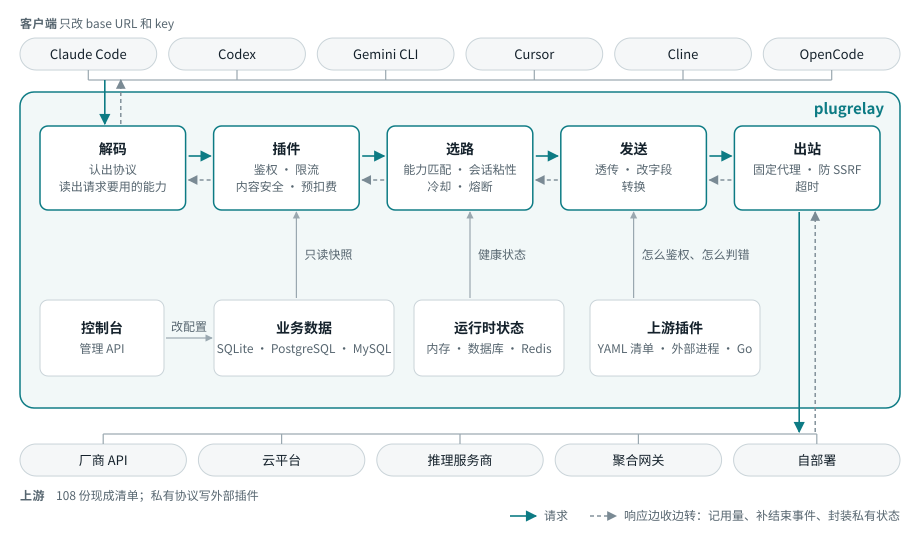
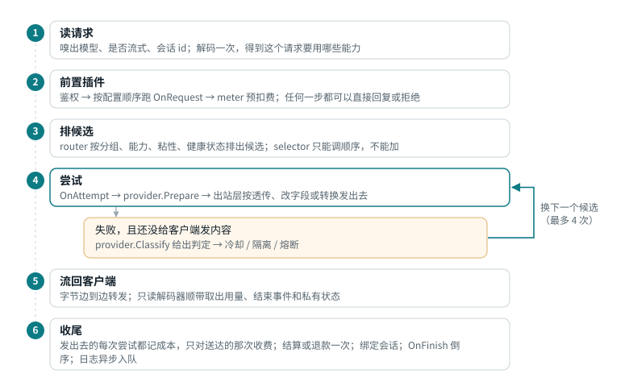
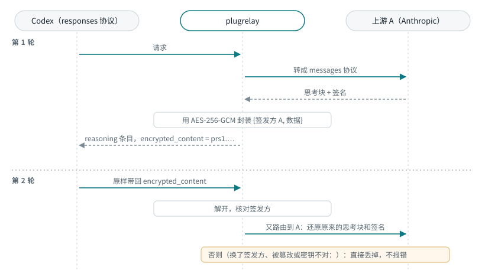

# 架构

[English](architecture.md) | 简体中文

一个请求在 plugrelay 里怎么走，每件事由哪个包决定。术语见
[`CONTEXT.md`](../CONTEXT.md)，长期决定见 [`docs/adr/`](adr/)。本文和代码对不上时，以代码为准。

- [全局](#big-picture)
- [一次请求](#request-lifecycle)
- [三种处理方式](#processing-tiers)
- [中间格式和能力](#ir-and-capabilities)
- [通用转换步骤](#generic-conversion-steps)
- [私有状态加密往返](#private-state-sealing)
- [选路、粘性和失败判定](#routing-stickiness-and-failure-verdicts)
- [流式、保活和超时](#streaming-keepalive-and-timeouts)
- [出站规则](#egress-rules)
- [存储分层](#storage-layers)
- [插件：功能、模块、扩展](#plugin-system-features-modules-extensions)
- [硬规则和落实位置](#hard-rules-and-where-they-are-enforced)

## 全局

核心代码不认识任何客户端或上游。客户端协议是 `pkg/protocol/<name>` 里的编解码器；上游是
provider 插件，大多数就是 `manifests/` 里的一份 YAML 清单。

`internal/app` 按 relay.yaml 把各部分装起来。`internal/server` 挂载各协议路由、WebSocket
升级、`/native/`、MCP 网关（`/mcp`）、管理 API（`/api/v1`）、插件路由
（`/api/plugins/<id>/`）、健康检查和指标接口，以及控制台。

## 一次请求

所有客户端协议、所有上游都走 `pipeline.ServeProtocol`，所以日志、计费、重试和错误渲染只在一处实现。
步骤以 `internal/pipeline/doc.go` 的包注释为准。

默认值（`internal/pipeline/deps.go`）：每个请求最多试 4 次；上游 5 秒没输出开始发保活，之后每 15 秒一次；
每个流事件的钩子最多跑 50 毫秒。

有三条路不走主流程：

| 路径 | 入口 | 区别 |
|-|-|-|
| 原生直通（默认关） | `pipeline.ServeNative` | 字节原样转给指定上游；不跑插件、不计费，只记一条日志 |
| 批量任务 | `pipeline.ServeBatch` | 新建文件或批次时挑一个声明了 `batches` 的入口，之后相关调用都发给同一把凭据；结果第一次被读取时计费 |
| WebSocket | `pipeline.ServeWebSocket` | 整个会话占一个并发名额；请求类插件按会话或按 `response.create` 跑；每个响应单独预扣、结算、记日志 |

细节见[原生直通](clients.zh-CN.md#native-passthrough)、[批量任务](clients.zh-CN.md#batches)、[WebSocket](clients.zh-CN.md#realtime-and-websocket)。

JSON 请求体里任何对象出现重复的键，都会在被读取之前以 400 `duplicate_key` 拒掉。中转读的是一个键第一次出现的值，
多数上游读最后一次的，重复的 `model` 或 `stream` 会让中转按一个请求选路计费，上游却按另一个请求处理。
批量任务的输入行和 WebSocket 客户端事件也做同样的检查。

## 三种处理方式

每次尝试都选能用的最轻的一种（`plugin.Tier`）：

| 方式 | 请求体 | 什么时候用 |
|-|-|-|
| `passthrough` 原样转发 | 一个字节都不改；只读解码器顺带看用量和结束事件 | 上游入口和客户端同协议、模型名相同、没有插件要改 |
| `patch` 改字段 | 用 sjson 原地改指定字段；字段顺序、`system` 数组、`cache_control` 都不动 | 改模型名、去掉过期的私有状态、输出上限字段改名、补 `stream_options.include_usage`、插件在 `Mutates` 里声明的改动 |
| `convert` 转换 | 解码成中间格式 → 通用步骤 → 按目标协议编码 | 上游入口是另一种协议 |

流式的 OpenAI chat 和 completions 请求会被补上 `include_usage`，让上游报真实用量；
因此多出来的那个只含用量的数据块在到达客户端前丢掉（`internal/pipeline/body.go` 的 `patchBody`）。

同协议改字段用编解码器的 `SetModel` 和 `StripOpaque`。插件在 patch 档通过 `plugin.BodyMutator`
改请求，只能改自己声明过的路径；在 convert 档则在 `OnAttempt` 里改中间格式。每次尝试用的哪一档都记在请求日志里。

## 中间格式和能力

- `pkg/ir`（中间格式 IR）能表达所有协议的内容，形状仿照 Anthropic 的内容块；流拆成一个个
  `ir.Event`。没有对应字段的内容放进 `Extra`，所以同协议来回一趟不丢东西。
- 编解码器只搬字段，不决定丢什么，代码里也不出现产品名。
- 每个编解码器声明自己的 `ir.Capabilities`，每个上游入口在清单里再收窄，实际生效的是两者交集。
- 解码得到 `ir.Needs`（请求要用哪些能力）。`convert.Assess` 拿它给每个入口评级：`lossless` 无损、
  `lossy` 有损、`discouraged` 不建议（两处以上重大损失，除非管理员允许否则跳过）、`impossible`
  不可能（永不选）。规则见 `internal/convert/convert.go` 的包注释。
- 向量、生图、语音、重排序这类编解码器标了 `MediaOnly`：只发给声明了对应操作的入口，文本请求也到不了它们。
  向量和重排序能跨格式转换，生图和语音只能原样转发。多部分上传不经服务器读取请求体，直接流给上游
  （`internal/pipeline/upload.go`）。
- `openai-completions` 只有提示词，只接 completions 客户端的请求。带 `suffix` 的代码补全请求只发给声明了
  `fill_in_middle` 的入口。

用量统一成五个互不重叠的桶，另加推理用量和上游原始数字（`ir.Usage`）；媒体类再加按单位计的数量
（图片张数、音频毫秒、字符数、重排序搜索单位）。

## 通用转换步骤

`convert.Request` 只跑两边能力有差别的步骤，每步都记进 `ir.Diagnostic`：跑了哪些、丢了哪些字段、哪些需求没满足。
任何步骤都不提客户端或上游的名字（`TestNoProductNames`）。

| 步骤 | 何时跑 | 做什么 |
|-|-|-|
| 缓存（`cache.go`） | 缓存方式不同 | 目标要显式断点就补在最后一个 system 块和最后两条消息上；不支持 1 小时缓存就缩短；目标按 key 缓存就用会话 id 填；目标没有缓存就去掉断点 |
| 工具（`tools.go`） | 目标缺某类工具 | 自由格式工具包成只有一个字符串参数的函数工具，回来时拆开；带命名空间的工具压平成 `<ns>__<name>`；服务端工具只是提供就去掉，必须用到就判这个入口不可能；服务端工具的历史改写成文本；延迟加载的工具展开 |
| 私有状态（`opaque.go`） | 历史或响应里有不透明状态 | 见[加密往返](#private-state-sealing) |
| 参数（`params.go`） | 参数体系不同 | 输出上限字段改名；effort 和思考预算按固定对照表互换（minimal 1024 … max 64000）；去掉不支持的参数 |
| 内容（`content.go`） | 目标缺某种内容形式 | 工具结果里的图片挪成单独的块；不支持的内容让入口变成不可能 |
| 用量（`usage.go`） | 总是 | 上游没报用量时估算一个，标为 `estimated` |

回程由 `response.go` 还原包装过、改过名的工具，封装新的私有状态，再按客户端协议输出事件。

## 私有状态加密往返

决策记录：[ADR-0003](adr/0003-seal-private-state-with-master-key.md)。

- 封装结果是 `prs1.` 加上 base64url(nonce ‖ 密文)，密钥由主密钥经 HKDF 派生（`internal/seal`）。
- 封装内容放在协议的回传字段里（`redacted_thinking`、`encrypted_content`、`thought_signature`）。
  OpenAI chat 没有这类字段，状态在这里会丢，诊断里会写明。
- 同协议原样转发时不封装。签发方变了的话，patch 档用 `StripOpaque` 去掉过期状态。

## 选路、粘性和失败判定

`internal/router` 从不可变的 `router.Table` 排候选；实时健康状态放在 `internal/state`，所有节点看到的一样。
确切顺序见 `internal/router/plan.go` 的 `Router.Plan`：

1. **解析名字。**模型就是它自己的路由。预设展开成其中的各个模型，每个一个回退层级；只在客户端请求的就是这个预设时才展开，
   中转从不自己换模型。
2. **剔除**不在调用方分组里的路由、停用的上游、评为不可能（或不建议）的入口、熔断中的上游，以及这些凭据：隔离中、冷却中、
   并发已满、属于别人的个人凭据、本请求已经试过的。清单允许不带 key（`auth.key_optional`）又没配凭据的上游，
   当作一把共享的免密凭据参与选路。
3. **同一上游内：**同协议入口优先，其次保真度高的，再次延迟低的。凭据方面，这个用户最近用过的优先，其次在途请求少的。
4. **路由之间：**先按回退层级，再按优先级，再按各自最好的入口。权重只用来分新会话。
5. **粘性优先：**有效的同轮令牌、其次有效的会话绑定，不管优先级都排最前。路由策略可以调整顺序，但不能加候选
   （[配置](configuration.zh-CN.md#routing-models-and-presets)）。

粘性跟着缓存价值走：只有上一轮读过或写过提示词缓存，绑定才继续有效，有效 5 分钟（写过 1 小时缓存则为 1 小时）。
每个用户 24 小时内最多留在最近用过的 3 把凭据上。Codex 的同轮令牌 6 小时过期。

尝试失败时，provider 返回一个 `plugin.Verdict`（失败判定），核心照着执行（`internal/router/health.go`）。
原因是 `request`、`transient`、`content` 的失败不改凭据状态。只有 `transient` 计入熔断：一分钟内 5 次就熔断
30 秒，之后放一个探测请求。没给结束时间的冷却按退避处理，30 秒起，每次翻倍，最长 30 分钟。

通用 provider 的内置判定（`plugins/provider/compatible/classify.go`），排在清单自己的 `errors` 规则之后：

| 上游的回应 | 原因 | 凭据 | 重试 |
|-|-|-|-|
| 没响应 / 超时 / 408、409、5xx | `transient` | 不变 | 下一个候选 |
| 内容过滤的信号或错误码 | `content` | 不变 | 哪里都不重试 |
| 400/401/403 看起来是账号被封 | `banned` | 隔离 | 不重试 |
| 400/403 提到使用政策或滥用；其他 403 | `unknown` | 隔离（从严） | 不重试 |
| 403 地区不支持 | `transient` | 不变 | 下一个 |
| 402、`insufficient_*`、额度用完 | `quota` | 冷却到上游给的重置时间 | 下一个 |
| 401 | `auth_expired` | 能刷新就刷新，否则冷却 | 下一个 |
| 429、529、过载的 503 | `rate_limit` | 只对这个模型冷却 | 下一个 |
| 上下文太长 | `request` | 不变 | 不重试（交给客户端压缩） |
| 404、405 | `request` | 不变 | 下一个 |
| 其他 4xx | `request` | 不变 | 不重试 |

如果 404/405/501 说的是路径本身（而不是某个模型或资源），这个入口还会被标记为一小时内不提供该操作。
这样一个不支持 `/completions` 的 OpenAI 兼容服务器只浪费一次 404，而不是每个请求一次（`internal/pipeline/unserved.go`）。

候选用完时，原因（`no_route`、`impossible`、`cooling`、`busy`、`exhausted`）按客户端协议的格式返回。

## 流式、保活和超时

- 字节边到边转发。第一个内容事件之前的输出先压着，好让重试干净地重来；之后这个请求就不再换上游。
- 保活（Anthropic 用 `ping`，其他协议用 SSE 注释行）不算内容。保活让 HTTP 200 先发出去以后，后面的失败只能以流内错误事件报告。
- 没有以结束事件收尾的流，会收到客户端协议的错误事件，绝不当作正常结束。计费至少按已转发的内容算：
  报告的用量低于按已转发字符数估出来的值，就用估算值，并标为 `estimated`（`internal/pipeline/cost.go` 的 `settleUsage`）。
- 每次尝试的计时器（`internal/egress/timers.go`）：连接（默认不限）、首字节 2 分钟、空闲 5 分钟、总时长 30 分钟。
  按上游覆盖见[配置](configuration.zh-CN.md#egress)。
- `pkg/sse` 是唯一的 SSE 解析器。超大事件报错，绝不悄悄丢掉。

## 出站规则

发往上游的流量都从 `internal/egress` 出去。

- **发出的请求头：**凭据、账号选择、分帧、逐跳以及客户端地址类的头一律不转发；provider 负责的头只带 provider 给的值。
  同协议时其余头原样转发（所以新的 `anthropic-beta` 值直接能用），跨协议时只带目标需要的。除了在一个 `User-Agent`
  都不剩时补一个，什么都不加。完整列表见 `OutboundHeaders`。
- **返回的响应头：**除逐跳头、`Set-Cookie`、`Alt-Svc` 和失效的分帧头之外全部带回，所以 `retry-after`、限流头和请求 id
  都能到客户端。
- **固定出口：**凭据用自己的代理，没有就用所属上游的，再没有才直连。代理挂了这次尝试就失败，不退回直连。
  provider 自己发起的调用（模型同步、额度探测、刷新令牌）也走同一个出口（[插件](plugins.zh-CN.md)）。
- 上游配置的**额外请求头**不能是 provider 负责的头或危险的头（`SetExtraHeaders`）。
- **防 SSRF：**每个要连的地址都检查。私有和回环网段一律拦截，除非在 `egress.allow_private_cidrs` 或上游设置里放行；
  NAT64、6to4 地址里嵌的 IPv4 也查。不跟随重定向。

## 存储分层

决策记录：[ADR-0004](adr/0004-two-level-pluggable-storage.md)。

| 层 | 存什么 | 驱动 | 包 |
|-|-|-|-|
| 启动配置 | 监听地址、主密钥、store 和 state 用哪种 | `relay.yaml` + `PLUGRELAY_*` 环境变量；plugrelay 从不写它 | `internal/config` |
| store 业务数据 | 管理员管的一切：用户、key、上游、加密的凭据、模型、预设、价格、设置、日志、计费记录 | SQLite（默认）、PostgreSQL、MySQL | `internal/store` |
| state 运行时状态 | 会话绑定、冷却、熔断、在途名额、限流窗口、锁 | 内存、数据库、Redis（多节点） | `internal/state` |

每次影响选路的写入，都在同一个事务里给版本号加一。`internal/app` 每 2 秒查一次，变了才重建不可变快照；
进行中的请求用它开始时的快照跑完。`plugrelay export` / `apply` 以 YAML 导出导入业务数据
（[配置](configuration.zh-CN.md#business-data-as-yaml)）。

## 插件：功能、模块、扩展

怎么写插件见[插件](plugins.zh-CN.md)，运维视角见[配置](configuration.zh-CN.md#features)。

- 策略都是插件，挂在这些扩展点上：`provider`、`auth`、`middleware`、`selector`、`meter`、`sink`、`job`、`admin`
  （`pkg/plugin/points.go`）。插件不加控制台页面；控制台页面是固定的，按功能开关决定显示哪些。
- 跑什么由 `internal/features` 决定。核心模块始终运行。一个功能就是一个开关加一张表单，管着一组内置模块。
  其他插件（外部进程、编进自定义构建的 Go 插件）都算扩展，一个一个单独开关。
- 插件有三种写法，对核心来说没区别：YAML 清单（只能写 provider）、通过 stdio 讲 JSON-RPC 的外部进程
  （[ADR-0011](adr/0011-external-plugins-json-rpc-go-sdk.md)）、编译进去的 Go 代码。
- 调用顺序：auth、`OnRequest`、selector、`meter.Reserve`，最后 `OnFinish` 和结算/退款，每个请求各一次；
  `OnAttempt` 每次尝试一次。前置钩子按配置顺序跑，可以直接回复；后置钩子倒序跑，只对前置钩子跑过的插件跑。
  `OnEvent` 只有内置插件能用，有耗时上限。
- 插件出错按它的 `FailPolicy` 处理：auth、meter、middleware 默认拒绝请求，sink 和 job 默认放行。

## 硬规则和落实位置

每次改动都必须守住的规则，以及守着每条规则的测试。

| # | 规则 | 落实位置 | 测试 |
|-|-|-|-|
| 1 | 流以本协议的结束事件收尾；流中途失败变成本协议的错误事件，绝不当作正常结束 | `internal/pipeline`（stream.go）、各编解码器的流编码器 | `TestKeepaliveThenFailureIsStreamError`、`TestUpstreamCutAfterContentRefunds`（internal/pipeline）；`TestStreamDecodeIncomplete`（anthropic、openairesponses） |
| 2 | 第一个内容事件之后不换上游；保活不算内容 | `internal/pipeline` | `TestNoRetryAfterContent`、`TestRetryOn429ThenSuccess`、`TestKeepaliveBeforeFirstByteThenRetry` |
| 3 | 同协议端点优先；用最低档位；直通逐字节一致 | `internal/router/plan.go`、`internal/pipeline` | `TestSameProtocolPreferred`（router）；`TestPassthroughByteExact`、`TestEmbeddingsPassthroughByteExact`（pipeline） |
| 4 | 通用步骤里不出现客户端或上游的名字 | `internal/convert` | `TestNoProductNames` |
| 5 | 满足不了需求的端点不路由；一个都不剩时才返回 400 | `internal/convert`（Assess）、`internal/router` | `TestAssessMatrix`、`TestAdmits`、`TestAssessMedia`（convert）；`TestCapabilityFiltering`（router）；`TestMediaCapabilityMissing`（pipeline） |
| 6 | 直通和原地修改时，`system` 数组、`cache_control` 和字段顺序都不动 | 编解码器的 `SetModel`/`StripOpaque`、`internal/pipeline` | `TestPassthroughByteExact`、`TestPatchChangesOnlyModel`（pipeline）；`TestSetModelByteExact`（openaichat） |
| 7 | 私有状态只回到它的签发方；跨协议时加密封装；读不出的封装内容悄悄丢弃 | `internal/seal`、`internal/convert/opaque.go` | `TestSealedReasoningRoundTrip`（pipeline）；`TestOpaqueHistory`、`TestOpaqueResponseRoundTrip`（convert）；`TestTamper`、`TestWrongKey`（seal） |
| 8 | 中转自己产生的错误用客户端协议原生的格式和信号 | 编解码器的 `EncodeError`、`internal/pipeline/errors.go` | `TestRelayErrorsAreNative`、`Test429CrossProtocolNative` |
| 9 | 上游的错误文本、状态码、`retry-after`、`x-should-retry`、限流头都能到达客户端 | `internal/egress/headers.go`、provider 的 `Classify` | `Test429PassthroughVerbatim`（pipeline）；`TestClientErrPassthrough`（compatible）；`TestInboundResponseHeaders`（egress） |
| 10 | 首字节 / 空闲 / 总时长超时；空闲时每 15 秒保活一次，从 5 秒后开始 | `internal/egress/timers.go`、`internal/pipeline` | `TestTimers`（egress）；`TestFirstByteTimeout`、`TestUpstreamTimeoutsOverrideDefaults`、`TestKeepaliveBeforeFirstByteThenRetry`（pipeline） |
| 11 | 会话 id 稳定；绑定记录的是实际发给上游的 id | `internal/pipeline`、`internal/router/session.go` | `TestSessionIDStableAcrossTurns`（pipeline）；`TestStickinessWindow`（router） |
| 12 | 用量是五个桶加原始用量；Anthropic 的总输入 = 输入 + 缓存读 + 缓存写 | 各编解码器、`ir.Usage.TotalInput` | `TestUsageBucketsAcrossCodecs`（pkg/protocol：每个编解码器的响应、流和客户端编码）；`TestUsageMapping`（openaichat）、`TestUsageFallback`（anthropic） |
| 13 | 超大的 SSE 事件是错误，绝不丢弃 | `pkg/sse` | `TestReaderMaxEventSize`（sse）；`pkg/plugin/plugintest` 的 `oversized_event` 场景（`TestFakeProviderAllProtocols`） |
| 14 | provider 负责的头只带 provider 的值；危险的头从不转发；不添加代理类的头 | `internal/egress/headers.go`、各 provider 的 `Prepare` | `TestOutboundHeaders`、`TestSetExtraHeaders`（egress）；`TestPrepareOwnsHeaders`（compatible）；`TestUpstreamExtraHeaders`（pipeline） |
| 15 | 凭据的出口是固定的，provider 自己发起的调用也一样；代理挂了就失败，绝不退回直连 | `internal/egress/client.go`、`internal/egress/plugin_clients.go`、`plugin.Outgoing.Client`、`Host.ClientFor`（`internal/app/plugins.go`） | `TestProxyFixedNoFallback`、`TestPluginClients`（egress）；`TestUpstreamProxy`、`TestProviderCallsUseAttemptEgress`（pipeline）；`TestBackgroundCallsHonourProxy`（internal/app）；`TestSendUsesAttemptEgress`（bedrock）；`TestTokenExchangeUsesCredentialEgress`（vertex）；`TestBackgroundCallsUseCredentialEgress`（compatible）；`TestHostHTTPCredentialEgress`（extplugin） |
| 16 | 疑似封号立即隔离且保持隔离（免密钥的自建上游没有凭据可恢复，只做冷却，也不持久化任何东西）；内容被拒在哪里都不重试；拿不准时从严 | 各 provider 的 `Classify`、`internal/router/health.go`、清单校验 | `TestHardRules16And17`（compatible）；`TestValidationHardRules`（manifest）；`TestCooldownAndQuarantine`、`TestKeylessUpstream`（router）；`TestKeylessUpstreamRoutes`（internal/app）；`TestContentViolationNotRetried`（pipeline） |
| 17 | 不是凭据本身问题的失败，从不改变凭据状态 | `internal/router/health.go` | `TestCooldownAndQuarantine`（router）；`TestHardRules16And17`（compatible） |
| 18 | 个人凭据只服务它的主人 | `internal/router/plan.go` | `TestPersonalCredentialIsolation` |
| 19 | 每次到达过上游的尝试都计成本；向调用方收费按 meter 的策略，默认只收送达的那一次 | `internal/pipeline/cost.go`、`meter.*` | `TestCostRecordedForFailedSentAttempt`、`TestMeterSettleOrRefundExactlyOnce`（pipeline）；`TestSettleRefundIdempotent`（quota） |
| 20 | `strictest` 合并的设置，下层永远不能放宽，除非这个键被豁免；白名单类设置某一层存的值无效时什么都不放行，绝不当作没有限制 | `internal/settings` | `TestHardRule20StrictestNeverLoosens`、`TestInvalidLayerFailsClosed`（settings）；`TestGroupAllowlistInvalidValueDeniesAll`（internal/app） |
| 21 | 模型同步：列表获取失败或为空时什么都不改；消失的模型只停用不删除；手动添加的模型不动 | `plugins/job/modelsync` | `TestRule21` |
| 22 | 默认不记录请求体；测试模式会关掉往本机之外发数据的插件 | `plugins/sink/requestlog`、`plugin.Info.ReportsOffBox`、`plugins/builtin`（`ForTestMode`）、`internal/app/plugins.go`（`PLUGRELAY_TEST_MODE`） | `TestBodyLogging`（requestlog）；`TestForTestMode`（builtin）；`TestTestModeDropsOffBoxPlugins`（internal/app） |
| 23 | 内置插件只能经核心出站层访问上游；扣费只能经 `meter` 改动，余额流水的每类写入只能由负责它的收费插件来做；外部插件崩溃绝不拖垮中转 | `pkg/plugin`（`Host.HTTPClient`、`Host.ClientFor`、`Outgoing.Client`）、`internal/pipeline/sinks.go`（每个 sink 拿到自己的一份记录副本）、`internal/extplugin` 的进程看护 | `TestPluginsUseCoreEgress`、`TestPluginsCannotChangeBalances`（plugins/boundary_test.go）；`TestSinkCannotChangeCharge`（pipeline）；`TestCrashRestart`、`TestDownCallsFailFast`（extplugin） |
| 24 | 控制台只调用公开的管理 API（计费页面另外可调用 收费功能文档里写明的插件路由） | `api/openapi.yaml`、`web/` | `internal/admin/openapi_test.go` 对照规范检查服务端；`scripts/lint.sh` 从规范重新生成控制台的类型化客户端，有出入就失败，`npm run typecheck` 会拒绝调用规范里没有的路径；`plugins/builtin/console_routes_test.go` 检查计费页面（`web/src/features/billing/`）调用的每个插件路由及其方法，确实由某个 sell kit 插件注册 |
| 25 | 控制台显示的凭据和上游状态就是路由器的实时状态 | `router.Live`（`internal/router/health.go`）、管理端 `Runtime.Live`（`internal/admin/credentials.go`）、每次重新加载时装上的路由表（`internal/app/runtime.go`） | `TestConsoleShowsRouterLiveState`（internal/app） |
