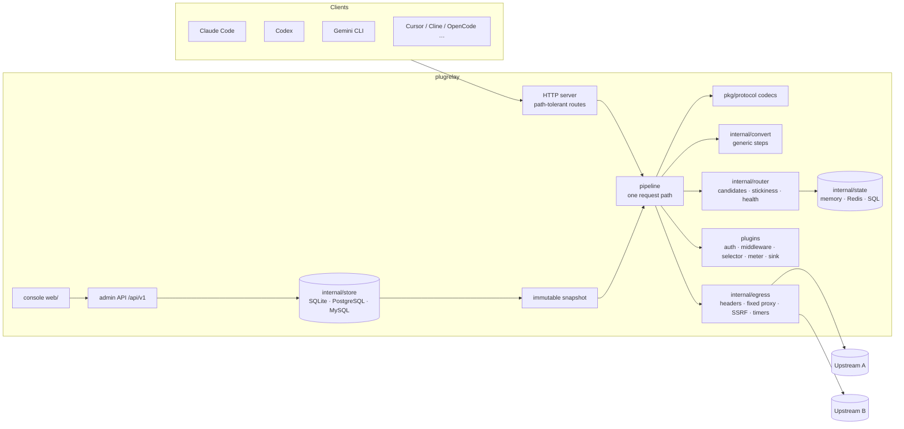
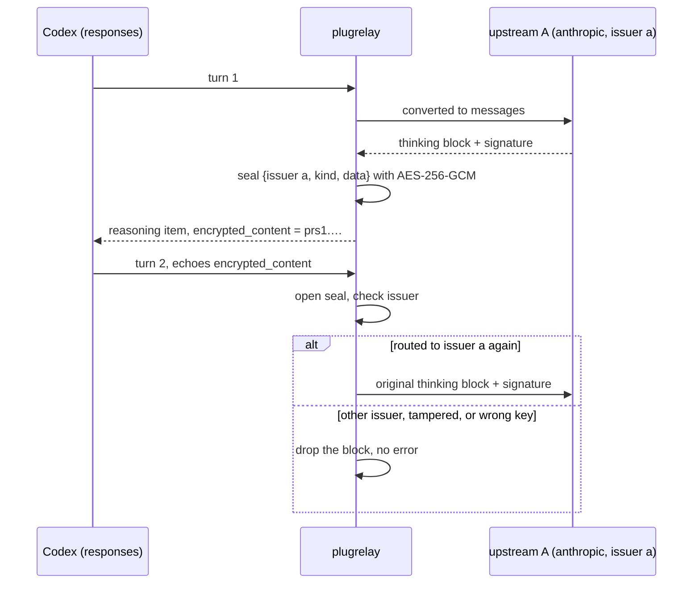

# 架构

[English](architecture.md) | 简体中文

一个请求在 plugrelay 里怎么走，每个决定由哪个包负责。
术语统一在 [`CONTEXT.md`](../CONTEXT.md) 里定义；长期有效的决定记在
[`docs/adr/`](adr/)。一切以代码为准，每一节都写明该去读哪个包。

- [全局视图](#big-picture)
- [请求的一生](#request-lifecycle)
- [处理档位](#processing-tiers)
- [中间表示 IR 与能力声明](#ir-and-capabilities)
- [通用转换步骤](#generic-conversion-steps)
- [私有状态的加密封装](#private-state-sealing)
- [路由、会话粘性与失败判定](#routing-stickiness-and-failure-verdicts)
- [流式、保活与超时](#streaming-keepalive-and-timeouts)
- [出站规则](#egress-rules)
- [存储分层](#storage-layers)
- [插件体系：功能、模块、扩展](#plugin-system-features-modules-extensions)
- [硬规则及其落实位置](#hard-rules-and-where-they-are-enforced)

<a id="big-picture"></a>
## 全局视图



核心不认识任何具体上游，也不点任何客户端的名。客户端协议是
`pkg/protocol/<name>` 里的编解码器（codec）；上游是 provider 插件，大多是
`manifests/` 里的声明式清单（manifest）。

组装：`internal/app` 按 relay.yaml 把所有东西搭起来；`internal/server`
负责分发 `/healthz`、`/readyz`、`/metrics`、各协议路由、WebSocket
升级（`/v1/realtime`、`/v1/responses`）、原生直通（`/native/`）、
MCP 网关（`/mcp`，`internal/mcp`，经核心出站层访问 MCP 服务器）、
管理 API（`internal/admin`，挂在 `/api/v1` 下）、插件的 HTTP 路由
（`/api/plugins/<id>/`）以及控制台。

<a id="request-lifecycle"></a>
## 请求的一生

所有客户端协议、所有上游都走 `pipeline.ServeProtocol`（`internal/pipeline/`），
所以日志、计费、重试和错误渲染只在一处做。步骤清单以
`internal/pipeline/doc.go` 的包注释为准，下面的图照着它画。有三条路不走这条主线：

- 原生直通（`pipeline.ServeNative`，默认关闭）：把字节原样转给指定上游，凭据由
  `Router.PlanUpstream` 挑选，走核心出站层；不跑插件、不计费，只记一条日志
  （[clients.md](clients.zh-CN.md#native-passthrough)）。
- 批处理 API（`pipeline.ServeBatch`）：新建文件或批次时用 `Router.Plan`
  挑一个声明了 `batches` 的端点，把用到的凭据和归属者记进存储，之后针对它的每次调用
  都发给同一个凭据；结果第一次被读取时经计量 meter 计费
  （[clients.md](clients.zh-CN.md#batches)）。
- WebSocket 会话（`pipeline.ServeWebSocket`：`/v1/realtime`、Responses 的
  WebSocket 模式）：用 `Router.Plan`（端点声明 `realtime`）或
  `Router.PlanUpstream`（`responses_websocket`）挑凭据，整个会话期间占住它的一个并发名额；
  请求类插件在一次没有请求体的调用上跑（每个会话一次，或每个 `response.create` 一次）；
  先经核心出站层拨通上游 WebSocket，再接受客户端连接；双向转发消息；每个响应都单独
  用 meter 预留并结算，各记一条日志（[clients.md](clients.zh-CN.md#realtime-and-websocket)）。

HTTP 服务器关机时不会关闭被接管（hijack）的连接，所以关机一开始就取消这些连接的 context。

```mermaid
sequenceDiagram
    autonumber
    participant C as Client
    participant P as pipeline
    participant H as plugins (auth, middleware, meter)
    participant R as router + selector
    participant V as provider plugin
    participant U as upstream
    participant S as sinks
    C->>P: POST /v1/messages (any client protocol)
    P->>P: sniff model, stream, session hints; resolve session id
    P->>P: decode once into IR → needs (read-only)
    P->>H: authenticate → OnRequest hooks (config order) → meter.Reserve
    H-->>P: pass / reply / reject
    P->>R: plan candidates (groups, capabilities, stickiness, health, caps)
    R-->>P: ordered candidates (selector may only reorder)
    loop until one succeeds, verdict allows retry, nothing sent to client yet
        P->>H: OnAttempt (per attempt)
        P->>V: Prepare (auth + owned headers)
        P->>U: send via egress (passthrough / patch / convert)
        alt success
            U-->>P: response / stream
        else failure before first content event
            U-->>P: error
            P->>V: Classify → Verdict
            P->>R: report verdict (cooldown / quarantine / breaker), re-plan excluding tried
        end
    end
    P-->>C: stream as it arrives (read-only decoder: usage, terminal event, seals)
    P->>H: cost every sent attempt, charge delivered one, settle or refund once; OnFinish (reverse)
    P->>R: bind session for stickiness
    P--)S: queue record (bounded, async)
```

几个值得知道的默认值（`internal/pipeline/deps.go`）：每个请求最多尝试 4 次；
保活每 15 秒一次，上游 5 秒没有输出才开始发；每个流式事件的钩子耗时预算是 50 毫秒。

JSON 请求体里只要有任何一个对象出现重复的键，就在别的代码读它之前以 400
`duplicate_key` 拒掉；OpenAI 批处理输入文件的每一行、Anthropic 批处理请求体同样如此，
WebSocket 客户端事件也返回同样的错误。原因是中转读的是一个键第一次出现的值，而多数上游
读最后一次的值，重复的 `model` 或 `stream` 会让中转按一个请求做检查、路由和计费，
上游却按另一个请求来服务（`internal/pipeline/websocket.go` 里的 `duplicateKey`）。

<a id="processing-tiers"></a>
## 处理档位

每次尝试都选能用的最低处理档位（`plugin.Tier`）：

| 档位 | 请求体怎么处理 | 什么时候用 |
|-|-|-|
| `passthrough`（直通） | 一个字节都不改；一个只读的流解码器盯着用量和结束事件 | 端点说的就是客户端的协议，模型名相同，没有插件改动 |
| `patch`（原地修改） | 用 sjson 就地改指定字段；字段顺序、`system` 数组和 `cache_control` 都保持原样 | 模型改名、换了签发方后去掉过期的私有状态、输出上限字段改名、补上 `stream_options.include_usage`（见下文）、插件在 `Mutates` 里声明的改动 |
| `convert`（转换） | 解码成 IR → 通用步骤 → 按目标协议编码 | 端点说的是另一种协议 |

流式的 OpenAI chat 或 completions 请求如果没带 `stream_options.include_usage`，
会被补上，让上游报告用量，而不是只能按字符数估算计费；由此多出来的最后一个只含用量的
chunk 在到达客户端之前就被丢掉，客户端拿到的仍是它要的那种流
（`internal/pipeline/body.go` 里的 `patchBody`）。

同协议的原地修改用编解码器的 `SetModel` 和 `StripOpaque`
（`pkg/protocol/codec.go`）。插件在 patch 档通过 `plugin.BodyMutator` 改请求，且只能改
自己声明过的路径；在 convert 档则在 `OnAttempt` 里改 IR。每次尝试用的档位都记在请求日志里。

<a id="ir-and-capabilities"></a>
## 中间表示 IR 与能力声明

- `pkg/ir` 是各协议表达能力的并集（`anthropic`、`openai-chat`、`openai-responses`、
  `gemini`，以及只有提示词的 `openai-completions`），形状仿照 Anthropic 的内容块；
  流会变成一个个 `ir.Event`。没有对应字段的内容原样存进 `Extra`，
  所以同协议来回一趟不丢东西。
- 编解码器只搬字段。它们从不决定丢什么，逻辑里也不能出现产品名
  （`pkg/protocol/codec.go` 的包注释）。
- 每个编解码器声明自己的 `ir.Capabilities`；每个端点再收窄（清单里的
  `capabilities`）。实际生效的是两者的交集。
- 解码得到 `ir.Needs`（请求需要什么）。`convert.Assess` 拿需求和实际能力比，给端点打分：
  `lossless`（无损）、`lossy`（有损）、`discouraged`（两处及以上重大损失；除非管理员允许，
  否则排除）或 `impossible`（永不路由）。打分规则见
  `internal/convert/convert.go` 的包注释。
- 媒体类操作有自己的编解码器（`openai-embeddings`、`gemini-embeddings`、
  `openai-images`、`openai-audio`、`rerank`、`cohere-rerank`，以及只用于上游的
  `tei-rerank`），都标了 `Capabilities.MediaOnly`：请求解码成 `Needs.Modality`，
  只路由到能力里声明了这个操作的端点；文本请求永远到不了它们。向量嵌入可以跨协议转换，
  经 `ir.Embed` / `Response.Embeddings`；重排序经 `ir.Rerank` / `Response.Ranks`
  （由客户端那边的编解码器处理 `top_n`，并从请求里补回文档）；图片和音频只能直通，
  计量用的数据放在 `ir.MediaUnits`。多部分上传路由（`Route.Upload`）的请求体服务器不读：
  `internal/pipeline/upload.go` 先读第一个文件之前的表单字段，再把各部分流式发给一个上游
  （如果 model 字段排在文件后面，就先存一份临时副本再重放）；`protocol.BodyStreamer`
  类的响应（语音音频、事件流）边到边转给客户端。
- 只有提示词的协议（`Capabilities.PromptOnly`：`openai-completions`）只接收来自
  同类客户端的请求；反过来转时，提示词变成一条用户消息（有损）。带 `suffix` 的请求
  （`Needs.FillInMiddle`）只发给声明了 `fill_in_middle` 的端点。

用量统一归成五个互不重叠的桶，外加推理用量和上游的原始用量
（`pkg/ir/response.go` 里的 `ir.Usage`）；媒体操作另加按单位计价的数量
（图片张数、音频毫秒数、字符数、重排序搜索单位）。

<a id="generic-conversion-steps"></a>
## 通用转换步骤

`convert.Request` 只跑两边能力有差异的那些步骤，并把每一步记进 `ir.Diagnostic`
（跑了哪些步骤、丢了哪些字段、哪些需求没满足）。任何步骤都不提客户端或上游的名字
（`TestNoProductNames`）。

| 步骤 | 何时运行 | 做什么 |
|-|-|-|
| 缓存（`cache.go`） | 缓存模式不同 | 目标要显式断点而请求里没有 → 放在最后一个 system 块和最后两条消息上；不支持 1 小时 TTL 就缩短；目标按键缓存 → 用会话 id 填缓存键；目标不支持缓存 → 去掉断点 |
| 工具（`tools.go`） | 目标缺某类工具 | 自由格式工具包成只有一个字符串参数的函数工具，回程时再拆开；带命名空间的工具压平成 `<ns>__<name>`（重名就用哈希），回程时再映射回来；服务端工具如果只是提供就去掉，如果是必需的（被 tool_choice 强制，或正在调用中）就判这个端点 impossible；服务端工具的历史改写成文本；延迟加载的工具展开 |
| 私有状态（`opaque.go`） | 历史或响应里带不透明状态 | 见[加密封装](#private-state-sealing) |
| 参数（`params.go`） | 参数体系不同 | 输出上限字段改名；effort 与 thinking 预算按固定对照表互转（minimal 1024 … max 64000），超出范围取最接近的值；去掉不支持的参数 |
| 内容（`content.go`） | 目标缺某种内容形式 | 工具结果里的图片挪到单独的块；不支持的内容会让端点变成 impossible |
| 用量（`usage.go`） | 总是 | 上游没报用量时估算一个（标记为 `estimated`） |

响应那一侧（`response.go`）把包装过、改过名的工具还原，给新的不透明状态加密封装，
再按客户端协议渲染事件。

<a id="private-state-sealing"></a>
## 私有状态的加密封装

决策记录：[ADR-0003](adr/0003-seal-private-state-with-master-key.md)。



- 封装后的内容以 `ir.SealPrefix`（`prs1.`）开头，后面是 nonce ‖ 密文 的 base64url；
  密钥由主密钥经 HKDF 派生（`internal/seal/seal.go`）。
- 只有带回传字段的协议才能携带封装内容（`Capabilities.EchoFields`：
  `redacted_thinking`、`encrypted_content`、`thought_signature`）。OpenAI chat 一个都没有，
  所以状态在那里会丢，诊断信息会写明。
- 同协议直通从不封装。如果签发方 issuer 变了，patch 档会用 `StripOpaque` 去掉过期状态。

<a id="routing-stickiness-and-failure-verdicts"></a>
## 路由、会话粘性与失败判定

`internal/router` 从不可变的 `router.Table` 生成候选；实时健康状态放在
`internal/state`，这样每个节点看到的是同一份。确切顺序请读
`internal/router/plan.go` 里的 `Router.Plan`。

1. 解析名字：模型就是它自己的路由；预设（preset）是其中调用方能用的每个模型，
   每个占一个回退层级，按预设里的顺序排（只在客户端请求的就是这个预设时才这样——
   中转从不自作主张换模型）。
2. 去掉：不在调用方分组里的路由、停用的上游、被判 impossible 的端点（discouraged
   除非允许）、熔断器打开的上游，以及这些凭据：被隔离的、在冷却中的（整个凭据或只针对
   这个模型）、并发已满的、属于其他用户的（`personal`）、本请求已经试过的。清单里
   允许不带密钥（`auth.key_optional`）且一个凭据都没有的上游属于免密钥上游：规划时当作
   一个 id 为 `""` 的共享凭据，不发鉴权头。其他没有可用凭据的上游没有路由
   （`router.Upstream.Keyless`）。
3. 同一个上游内部：同协议端点优先，其次保真度更高的，再次延迟更低的。凭据方面，
   这个用户最近用过的优先，其次在途请求更少的。
4. 路由按回退层级排，其次按优先级（高的在前），再按各自最好的端点（规则同第 3 步）；
   新会话在同样合适的路由之间按权重分流，已有会话不分。
5. 有效的同轮令牌（turn token）、其次有效的会话绑定，不管优先级都排最前。路由策略
   （`selector.routing`，或预设自己的挑选策略）可以重排，但不能加候选
   （[配置](configuration.zh-CN.md#routing-models-and-presets)）。

粘性跟着缓存价值走：只有上一轮读过或写过提示词缓存，绑定才继续有效，有效期 5 分钟
（写过 1 小时缓存则为 1 小时）。每个用户 24 小时内最多固定在最近用过的 3 个凭据上。
同轮令牌（Codex 的同一轮请求头）6 小时后过期。

一次尝试失败时，provider 返回一个 `plugin.Verdict`（失败判定），核心只负责执行
（`internal/router/health.go`）。原因为 `request`、`transient` 和 `content` 的失败，
无论判定要求什么动作，都不会改变凭据状态。只有 `transient` 失败计入上游熔断器
（一分钟内 5 次失败就打开 30 秒，之后放一个探测请求）。没有给结束时间的冷却按退避处理：
30 秒起，每犯一次翻倍，最长 30 分钟。

通用 provider 内置的判定（`plugins/provider/compatible/classify.go`），在清单自己的
`errors` 规则之后生效：

| 上游的回应 | 原因 | 凭据 | 重试 |
|-|-|-|-|
| 没有响应 / 超时 / 408、409、5xx | `transient` | 保持 | 下一个候选 |
| 内容过滤的信号或错误码 | `content` | 保持 | 不重试，哪里都不试 |
| 400/401/403 看起来像账号被封 | `banned` | 隔离 | 不重试 |
| 400/403 提到使用政策或滥用；其他 403 | `unknown` | 隔离（从严） | 不重试 |
| 403 地区不支持 | `transient` | 保持 | 下一个 |
| 402、`insufficient_*`、额度信号 | `quota` | 冷却到上游的重置时间 | 下一个 |
| 401 | `auth_expired` | provider 能刷新就刷新，否则冷却 | 下一个 |
| 429、529、过载的 503 | `rate_limit` | 只对这个模型冷却（按 retry-after 或重置时间） | 下一个 |
| 上下文太长 | `request` | 保持 | 不重试（由客户端压缩） |
| 404、405 | `request` | 保持 | 下一个 |
| 其他 4xx | `request` | 保持 | 不重试 |

针对路径本身的 404/405/501（空响应体、服务器的普通页面、光秃秃的 "Not Found"、
"invalid URL"；提到模型、部署或其他资源的不算）还会把这个端点标记为一小时内不提供这个操作，
记在共享状态里；只要还有别的候选，规划时就跳过它（`internal/pipeline/unserved.go`）。
这样一个不支持 `/completions` 的通用 OpenAI 兼容服务器只会浪费一次 404，而不是每个请求一次。

候选全部用完时，规划错误的类别（`no_route`、`impossible`、`cooling`、`busy`、
`exhausted`）会变成客户端自己协议格式的错误。

<a id="streaming-keepalive-and-timeouts"></a>
## 流式、保活与超时

- 字节边到边转发。第一个内容事件之前的输出先压着不发，这样重试可以干干净净地重来；
  第一个内容事件之后，这个请求就再也不会换上游。
- 保活（Anthropic 用 `ping`，其他协议用 SSE 注释行）在上游 5 秒没有输出后开始，
  空闲期间每 15 秒一次。保活不算内容。一旦保活让 HTTP 200 已经发出去，之后的失败就只能
  以流内错误事件的形式报告。
- 没有以本协议结束事件收尾的流，会收到客户端协议的错误事件，绝不会被当作正常结束。
  计费至少按已收到的输出算：如果目前报告的用量低于按已转发字符数估出来的值，就用估算值，
  并把用量标为 `estimated`（`internal/pipeline/cost.go` 里的 `settleUsage`）。
- 每次尝试的计时器（`internal/egress/timers.go`）：连接（默认不限，除非上游设置了）、
  首字节（2 分钟）、分块之间的空闲（5 分钟）、总时长（30 分钟）。默认值和按上游覆盖见
  [配置](configuration.zh-CN.md#egress)。
- `pkg/sse` 是唯一的 SSE 解析器；超大事件是错误，绝不悄悄丢掉。

<a id="egress-rules"></a>
## 出站规则

所有发往上游的流量都从 `internal/egress` 出去：

- **发出的请求头**（`OutboundHeaders`）：凭据、账号选择、分帧、逐跳以及客户端地址类的头
  （`Authorization`、`X-Api-Key`、`X-Goog-Api-Key`、`Api-Key`、`OpenAI-Organization`、
  `OpenAI-Project`、`Cookie`、`Host`、`Content-Length`、`Accept-Encoding`、`Forwarded`、
  `Via`、`X-Real-IP` 等）一律不转发；provider 自己负责的头只带 provider 给的值。
  同协议时其余头原样转发（所以新的 `anthropic-beta` 值能直接用）。跨协议时只带目标需要的头。
  除了在一个 `User-Agent` 都没剩下时补一个，什么都不加。
- **返回的响应头**（`InboundResponseHeaders`）：除逐跳头、`Set-Cookie`、`Alt-Svc`
  和已失效的分帧头外全部带回——所以 `retry-after`、`x-should-retry`、限流头和请求 id
  都能到达客户端。
- **固定出口**：每个凭据只有一个代理：它自己的，否则它所属上游的，否则直连。代理挂了，
  这次尝试就失败，绝不退回直连。provider 自己发起的调用也走同样的出口：尝试期间用
  `Outgoing.Client`，模型同步、额度探测和刷新用 `Host.ClientFor`
  （[插件](plugins.zh-CN.md)）。
- 上游配置的**额外请求头**经过 `SetExtraHeaders`：绝不能是 provider 负责的头或危险的头。
- **SSRF 防护**：每个要拨的地址都检查；私有和回环网段一律拦截，除非列在
  `egress.allow_private_cidrs` 里，或者上游标记了允许私有地址；NAT64 或 6to4
  地址里内嵌的 IPv4 也会检查。不跟随重定向。

<a id="storage-layers"></a>
## 存储分层

决策记录：[ADR-0004](adr/0004-two-level-pluggable-storage.md)。

| 层 | 存什么 | 驱动 | 包 |
|-|-|-|-|
| 启动配置 | 监听地址、主密钥、store/state 选哪种 | `relay.yaml` + `PLUGRELAY_*` 环境变量；plugrelay 从不写它 | `internal/config` |
| store | 用户、分组、密钥、上游、凭据（加密）、模型、路由、预设、价格、站点设置、功能开关状态、扩展配置、分层的插件设置、清单、请求日志及按小时汇总、审计日志、插件 KV、批处理对象（每个批次和文件在哪、归谁、是否已计费）、通知渠道（密钥加密封装）和通知日志、登录身份和第二因素、价格同步建议、售卖套件 sell kit 的余额流水账、兑换码、订阅、支付订单、优惠券和邀请返利 | SQLite（默认，纯 Go）、PostgreSQL、MySQL | `internal/store` |
| state | 会话绑定、冷却、熔断器、在途名额、限流窗口、锁 | 内存（单节点）、SQL（单节点，重启后保留）、Redis（集群） | `internal/state` |

每次和路由有关的写入都会在同一个事务里给版本计数器加一；核心轮询这个计数器，
只在它变了时才重建不可变快照。进行中的请求用它开始时的快照跑完。`plugrelay export` /
`apply` 以 YAML 导出、导入业务数据（[配置](configuration.zh-CN.md#business-data-as-yaml)）。

`internal/app` 每 2 秒轮询一次版本（`PollEvery`）。

<a id="plugin-system-features-modules-extensions"></a>
## 插件体系：功能、模块、扩展

细节和操作指南见 [plugins.md](plugins.zh-CN.md)；运维视角见
[配置](configuration.zh-CN.md#features)。简单说：

- 策略都是插件，挂在扩展点上：`provider`、`auth`、`middleware`、`selector`、`meter`、
  `sink`、`job`、`admin`（`pkg/plugin/points.go`）。插件不加控制台界面；控制台的页面是固定的，
  按功能开关决定显示哪些。
- 跑什么由 `internal/features` 决定：核心模块始终运行；一个功能（feature）就是一个开关加
  一张设置表单，管着一组内置模块，开关打开时这些模块才运行，关掉就停（状态存在 store 里）；
  其他插件（外部进程、编进自定义构建的 Go 插件）都是扩展（extension），一个一个单独开关。
  `App.states`（`internal/app/plugins.go`）在每次重新加载时依次处理这些，然后处理
  `Requires`，再处理测试模式。
- 写插件有三种方式，对核心来说扩展点和设置都一样：YAML 清单（只能写 provider）、
  通过 stdio 讲 JSON-RPC 的外部进程（[ADR-0011](adr/0011-external-plugins-json-rpc-go-sdk.md)），
  或者编译时注册的内置 Go 代码。
- 调用顺序：auth、`OnRequest`、selector、`meter.Reserve`、`OnFinish` 以及结算/退款，
  每个请求各一次；`OnAttempt` 每次尝试一次。前置钩子按配置顺序跑，后置钩子倒序跑，
  而且只对前置钩子跑过的插件跑。任何前置钩子都可以直接给出回复。`OnEvent` 只有内置插件能用，
  每个事件有耗时预算。
- 插件出故障时按它声明的故障策略 `FailPolicy` 处理：auth、meter 和 middleware 默认
  `closed`（拒绝请求），sink 和 job 默认 `open`（放行）。

<a id="hard-rules-and-where-they-are-enforced"></a>
## 硬规则及其落实位置

每次改动都必须守住的规则，以及钉住每条规则的测试。

| # | 规则 | 落实位置 | 测试 |
|-|-|-|-|
| 1 | 流以本协议的结束事件收尾；流中途失败变成本协议的错误事件，绝不当作正常结束 | `internal/pipeline`（stream.go）、各编解码器的流编码器 | `TestKeepaliveThenFailureIsStreamError`、`TestUpstreamCutAfterContentRefunds`（internal/pipeline）；`TestStreamDecodeIncomplete`（anthropic、openairesponses） |
| 2 | 第一个内容事件之后不换上游；保活不算内容 | `internal/pipeline` | `TestNoRetryAfterContent`、`TestRetryOn429ThenSuccess`、`TestKeepaliveBeforeFirstByteThenRetry` |
| 3 | 同协议端点优先；用最低档位；直通逐字节一致 | `internal/router/plan.go`、`internal/pipeline` | `TestSameProtocolPreferred`（router）；`TestPassthroughByteExact`、`TestEmbeddingsPassthroughByteExact`（pipeline） |
| 4 | 通用步骤里不出现客户端或上游的名字 | `internal/convert` | `TestNoProductNames` |
| 5 | 满足不了需求的端点不路由；一个都不剩时才返回 400 | `internal/convert`（Assess）、`internal/router` | `TestAssessMatrix`、`TestAdmits`、`TestAssessMedia`（convert）；`TestCapabilityFiltering`（router）；`TestMediaCapabilityMissing`（pipeline） |
| 6 | 直通和原地修改时，`system` 数组、`cache_control` 和字段顺序都不动 | 编解码器的 `SetModel`/`StripOpaque`、`internal/pipeline` | `TestPassthroughByteExact`、`TestPatchChangesOnlyModel`（pipeline）；`TestSetModelByteExact`（openaichat） |
| 7 | 私有状态只回到它的签发方；跨协议时加密封装；读不出的封装内容悄悄丢弃 | `internal/seal`、`internal/convert/opaque.go` | `TestSealedReasoningRoundTrip`（pipeline）；`TestOpaqueHistory`、`TestOpaqueResponseRoundTrip`（convert）；`TestTamper`、`TestWrongKey`（seal） |
| 8 | 中转自己产生的错误用客户端协议原生的格式和信号 | 编解码器的 `EncodeError`、`internal/pipeline/errors.go` | `TestRelayErrorsAreNative`、`Test429CrossProtocolNative` |
| 9 | 上游的错误文本、状态码、`retry-after`、`x-should-retry`、限流头都能到达客户端 | `internal/egress/headers.go`、provider 的 `Classify` | `Test429PassthroughVerbatim`（pipeline）；`TestClientErrPassthrough`（compatible）；`TestInboundResponseHeaders`（egress） |
| 10 | 首字节 / 空闲 / 总时长超时；空闲时每 15 秒保活一次，从 5 秒后开始 | `internal/egress/timers.go`、`internal/pipeline` | `TestTimers`（egress）；`TestFirstByteTimeout`、`TestUpstreamTimeoutsOverrideDefaults`、`TestKeepaliveBeforeFirstByteThenRetry`（pipeline） |
| 11 | 会话 id 稳定；绑定记录的是实际发给上游的 id | `internal/pipeline`、`internal/router/session.go` | `TestSessionIDStableAcrossTurns`（pipeline）；`TestStickinessWindow`（router） |
| 12 | 用量是五个桶加原始用量；Anthropic 的总输入 = 输入 + 缓存读 + 缓存写 | 各编解码器、`ir.Usage.TotalInput` | `TestUsageBucketsAcrossCodecs`（pkg/protocol：每个编解码器的响应、流和客户端编码）；`TestUsageMapping`（openaichat）、`TestUsageFallback`（anthropic） |
| 13 | 超大的 SSE 事件是错误，绝不丢弃 | `pkg/sse` | `TestReaderMaxEventSize`（sse）；`pkg/plugin/plugintest` 的 `oversized_event` 场景（`TestFakeProviderAllProtocols`） |
| 14 | provider 负责的头只带 provider 的值；危险的头从不转发；不添加代理类的头 | `internal/egress/headers.go`、各 provider 的 `Prepare` | `TestOutboundHeaders`、`TestSetExtraHeaders`（egress）；`TestPrepareOwnsHeaders`（compatible）；`TestUpstreamExtraHeaders`（pipeline） |
| 15 | 凭据的出口是固定的，provider 自己发起的调用也一样；代理挂了就失败，绝不退回直连 | `internal/egress/client.go`、`internal/egress/plugin_clients.go`、`plugin.Outgoing.Client`、`Host.ClientFor`（`internal/app/plugins.go`） | `TestProxyFixedNoFallback`、`TestPluginClients`（egress）；`TestUpstreamProxy`、`TestProviderCallsUseAttemptEgress`（pipeline）；`TestBackgroundCallsHonourProxy`（internal/app）；`TestSendUsesAttemptEgress`（bedrock）；`TestTokenExchangeUsesCredentialEgress`（vertex）；`TestBackgroundCallsUseCredentialEgress`（compatible）；`TestHostHTTPCredentialEgress`（extplugin） |
| 16 | 疑似封号立即隔离且保持隔离（免密钥的自建上游没有凭据可恢复，只做冷却，也不持久化任何东西）；内容被拒在哪里都不重试；拿不准时从严 | 各 provider 的 `Classify`、`internal/router/health.go`、清单校验 | `TestHardRules16And17`（compatible）；`TestValidationHardRules`（manifest）；`TestCooldownAndQuarantine`、`TestKeylessUpstream`（router）；`TestKeylessUpstreamRoutes`（internal/app）；`TestContentViolationNotRetried`（pipeline） |
| 17 | 不是凭据本身问题的失败，从不改变凭据状态 | `internal/router/health.go` | `TestCooldownAndQuarantine`（router）；`TestHardRules16And17`（compatible） |
| 18 | 个人凭据只服务它的主人 | `internal/router/plan.go` | `TestPersonalCredentialIsolation` |
| 19 | 每次到达过上游的尝试都计成本；向调用方收费按 meter 的策略，默认只收送达的那一次 | `internal/pipeline/cost.go`、`meter.*` | `TestCostRecordedForFailedSentAttempt`、`TestMeterSettleOrRefundExactlyOnce`（pipeline）；`TestSettleRefundIdempotent`（quota） |
| 20 | `strictest` 合并的设置，下层永远不能放宽，除非这个键被豁免；白名单类设置某一层存的值无效时什么都不放行，绝不当作没有限制 | `internal/settings` | `TestHardRule20StrictestNeverLoosens`、`TestInvalidLayerFailsClosed`（settings）；`TestGroupAllowlistInvalidValueDeniesAll`（internal/app） |
| 21 | 模型同步：列表获取失败或为空时什么都不改；消失的模型只停用不删除；手动添加的模型不动 | `plugins/job/modelsync` | `TestRule21` |
| 22 | 默认不记录请求体；测试模式会关掉往本机之外发数据的插件 | `plugins/sink/requestlog`、`plugin.Info.ReportsOffBox`、`plugins/builtin`（`ForTestMode`）、`internal/app/plugins.go`（`PLUGRELAY_TEST_MODE`） | `TestBodyLogging`（requestlog）；`TestForTestMode`（builtin）；`TestTestModeDropsOffBoxPlugins`（internal/app） |
| 23 | 内置插件只能经核心出站层访问上游；扣费只能经 `meter` 改动，预付费流水账的每类写入只能由拥有它的 sell kit 插件来做；外部插件崩溃绝不拖垮中转 | `pkg/plugin`（`Host.HTTPClient`、`Host.ClientFor`、`Outgoing.Client`）、`internal/pipeline/sinks.go`（每个 sink 拿到自己的一份记录副本）、`internal/extplugin` 的进程看护 | `TestPluginsUseCoreEgress`、`TestPluginsCannotChangeBalances`（plugins/boundary_test.go）；`TestSinkCannotChangeCharge`（pipeline）；`TestCrashRestart`、`TestDownCallsFailFast`（extplugin） |
| 24 | 控制台只调用公开的管理 API（计费页面另外可调用 sell kit 文档里写明的插件路由） | `api/openapi.yaml`、`web/` | `internal/admin/openapi_test.go` 对照规范检查服务端；`scripts/lint.sh` 从规范重新生成控制台的类型化客户端，有出入就失败，`npm run typecheck` 会拒绝调用规范里没有的路径；`plugins/builtin/console_routes_test.go` 检查计费页面（`web/src/features/billing/`）调用的每个插件路由及其方法，确实由某个 sell kit 插件注册 |
| 25 | 控制台显示的凭据和上游状态就是路由器的实时状态 | `router.Live`（`internal/router/health.go`）、管理端 `Runtime.Live`（`internal/admin/credentials.go`）、每次重新加载时装上的路由表（`internal/app/runtime.go`） | `TestConsoleShowsRouterLiveState`（internal/app） |
